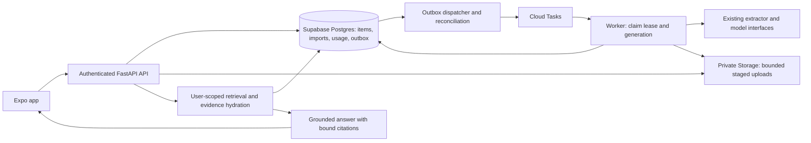

> **Review update (2026-10-18):** Latest review is
> `LUNA_IMPORT_REVIEW_2026-10-18.md`; follow Batch A–F in
> `LUNA_NEXT_IMPLEMENTATION_PLAN.md`. R12 ambiguous-commit source deletion and
> R13 missing import write fences reopen T03/T06 source acceptance. R14 retry
> counter loss is reproduced. The suite passes 410 tests with 29 skips; these
> results do not close the new findings or database/device/cloud gates.

# SpillTheReel implementation plan for GPT-6 Luna

Prepared 2026-10-18. Status: **active implementation ledger; see latest execution entry**. This replaces HANDOFF.md as the execution entry point.

Read [AGENTS.md](../AGENTS.md), the [current-state review](PROJECT_REVIEW_2026-10-16.md),
and the [design brief](DESIGN_EXECUTION_BRIEF.md). Original sequencing remains in
[buildphase.md](../buildphase.md), subject to its dated override. Tooling setup is
in [AGENT_SETUP.md](AGENT_SETUP.md). A ready-to-paste prompt is in
[LUNA_START_PROMPT.md](LUNA_START_PROMPT.md).

## 1. Outcome and boundaries

Deliver a trustworthy private mobile library: capture a social URL or import a
supported export, fully ingest accepted media, show honest progress, retrieve the
content with grounded answers, open the original, organize it, and delete it safely.
Finish the existing app instead of rebuilding its stack.

Keep Expo/React Native/Router, FastAPI, Supabase Auth/Postgres/Storage, pgvector,
Cloud Run/Cloud Tasks, and current extractor/provider interfaces. Preserve existing
auth, chat, item detail and backend work. Android is the first device acceptance
target; iOS release remains gated on credentials and native validation. Do not
upgrade the SDK as a substitute for diagnosing a build failure.

The planning batch installed tooling and wrote docs; it did not implement the
product tickets below. Installation of an MCP does not authorize deployment,
live migrations, production data deletion or paid extraction. Local changes and
isolated checks can proceed. Identify external blockers precisely and continue
independent tasks.

## 2. Product rules: confirmed versus proposed

### Confirmed by the owner

| Rule | Required behavior |
|---|---|
| Full ingestion | Every accepted imported media item enters the full ingestion pipeline. Export metadata does not replace transcription/analysis. No automatic age-based or cost-based downgrade to text-only |
| Free allowance | 250 bulk-import items **once per account**: up to 150 Instagram plus up to 100 pooled across all other supported apps |
| Premium allowance | 1,000 bulk-import items **once per account**, pooled across all supported apps |
| Reset | No monthly reset and no new allowance on another ZIP/upload/retry |
| Individual saves | These are bulk-import allowances, not a new share-sheet-save limit |
| Source support | Preserve existing save-platform support. A working URL extractor does not prove a bulk-export adapter exists |

### Proposed defaults: implement seams, resolve before enabling affected behavior

These are recommendations, not extra owner decisions. Record answers as dated
decisions in section 8. Unresolved choices must not silently become production rules.

| ID | Proposed default | Why / release boundary |
|---|---|---|
| D01 Upgrade/downgrade | Premium is a total lifetime ceiling of 1,000, including earlier free imports; e.g. 250 already used leaves 750. On downgrade retain existing items; further free admission must meet both free bucket caps and total history | Avoid accidental additive 1,250 allowance; owner must confirm upgrade/downgrade semantics before premium activation |
| D02 Charge/refund | Reserve and consume at durable admission of a unique eligible media item; retries do not charge again. Invalid, duplicate, unsupported, or unselected rows do not consume. No automatic refund after provider work begins; auditable administrative credits only | Avoid repeated failed-source abuse. Cancellation-before-work and refunds require owner confirmation before charging real users |
| D03 Media versus audio | Count unique admitted media items, not each collection occurrence or metadata-only saved-audio record. Keep saved-audio metadata outside this media allowance unless it enters a separate ingestion product | Current IG parser includes saved music; owner needs to confirm whether it is in the promised allowance |
| D04 Billing authority | Use a server-owned entitlement interface with synthetic/free fixtures first. Select payment provider, prices, checkout/store purchase approach and verification/webhooks before selling Premium | Client cannot self-assign premium. Do not invent pricing or launch a payment integration based on old PRD monetization notes |
| D05 Other bulk formats | Instagram first; add TikTok, YouTube and X adapters only after verifying an actual export format containing saved-item URLs. Unsupported formats stay disabled with honest copy | Platform save support and export availability differ. A URL-list import can be a separate supported option, not mislabeled as a native export |
| D06 Retention | Delete temporary media when its job ends; keep staged archive only for a bounded retry/preview window; clean abandoned previews on expiry. Persist necessary extracted text and thumbnails until item/account deletion | Exact archive expiry and privacy copy must be agreed and implemented together; no invented immediate-deletion promise |

Do not block T01–T04, design foundations or adapter research on these decisions.
Build quota calculations with explicit policy inputs and isolated fixtures, but
gate production admission/billing behavior affected by D01–D04 until resolved.
Make that gate enforceable: production bulk admission is disabled or returns an
explicit policy-not-configured response until an owner-approved policy version is
configured. Do not default to proposed upgrade/refund/audio rules or leave the old
unrestricted import route available. Policy-dependent UI must show unavailable
state instead of claiming an active entitlement. Apply the same gate to staged
upload retention until D06's expiry and cleanup configuration is selected.
The same account's usage must survive logout/reinstall and item deletion. Deleting
and recreating an identity is a separate abuse/product policy; do not add invasive
identity retention or fingerprinting under the guise of “once per account.”

## 3. Target architecture and invariants

This is the target, not a diagram of completed features. Keep one Alembic history.
The primary agent owns model/schema contract integration and migration ordering.

Required invariants:

1. A successful acceptance response means durable intent exists, even if Cloud
   Tasks is temporarily unavailable. Item/admission/outbox writes share a transaction.
2. Dispatch may repeat. A job identity includes operation, target and generation.
   Retrying the same generation is idempotent; a deliberate new attempt gets a new
   generation. Cloud Tasks dedup is not the database's business correctness boundary.
3. Workers claim a short DB lease atomically, release the transaction before
   external calls, and commit results only if their generation/lease still owns
   the work and the account/item is active. Completed duplicate deliveries do no
   paid work. Lease expiry/recovery cannot let a stale worker overwrite a winner.
4. Bulk admission serializes per account. Two concurrent uploads cannot both spend
   the last slot. Import duplicates and manual-save duplicates are recognized by
   the existing canonical URL identity before creating a charged reservation.
5. Import counts derive from durable membership/state, not process-local counters.
   A retry cannot double-count completion or reduce previously recorded totals.
6. Retrieval returns unique active owned items. Answer evidence and cards share
   one contiguous index map. Citation `(index,item_id)` pairs must match that map.
7. Account deletion prevents new jobs and blocks late writes before data is purged;
   retries continue until the durable deletion workflow is terminal.
8. Every user-visible state comes from persisted server truth or is clearly a local
   pending action. No fake success, connected-account status, counts or charts.

### Proposed schema additions

Names are design proposals to finalize in T01/T05, not instructions to create all
tables blindly. Prefer the smallest schema that preserves the invariants.

| Entity | Purpose / important constraints |
|---|---|
| `job_outbox` | Operation, target, generation, minimal payload, ready time, dispatch attempts/error and delivered time; unique logical job identity; due-work index |
| Processing attempt/lease | On item or a separate attempt row: generation, lease owner, lease expiry, heartbeat, attempt count, bounded failure code; conditional completion updates |
| `import_entries` | Import + canonical entry identity, platform, selected/admitted/duplicate/rejected status, item link, failure reason and collection provenance; unique within import; owner consistency |
| `import_usage` and account usage lock/counters | Immutable admission identity linked to item/import and source bucket; unique charged event; lifetime counters/reservations updated atomically; deletion of an item does not erase consumed usage |
| Entitlement snapshot | Trusted server tier/source/version, optional expiry; never writable as premium by mobile clients; store billing events separately if a provider is selected |
| Deletion job/tombstone | Durable workflow identity, stage, retries and account fence that survives profile removal until auth/storage purge is confirmed; define minimization/retention explicitly |
| Cost usage/reservations | Per-operation estimated reservation and actual usage, provider/model/outcome, idempotency key; independent of bulk item allowance |

All new owner-scoped tables need grants, RLS and foreign-key ownership consistency.
Internal queue/billing tables must not become mobile-writeable just because they
live in `public`. Composite constraints or equivalent transactional validation
must prevent cross-user joins and embeddings. Account deletion policy covers new
tables too. Backfills for existing imports must not guess lifetime usage from
partial counters: inventory affected accounts and require a documented one-time
reconciliation decision before enforcing historical consumption.

### API contract direction

Preserve existing `/v1` naming and snake_case conventions. Finalize field schemas
before frontend tasks; generate or verify mobile types from OpenAPI in CI.

| Capability | Proposed contract evolution |
|---|---|
| Allowance | `GET /v1/me/import-allowance`: tier, lifetime policy/version, consumed/reserved/remaining total and bucket values, permitted source capabilities |
| Upload/preview | Extend `POST /v1/imports` to create a staged preview asynchronously with an idempotency key; status includes discovered/eligible/duplicate/unsupported counts; paginated entries for selection |
| Commit selection | `POST /v1/imports/{id}/commit`: explicit entry IDs or a bounded selection token tied to preview version, idempotency key; atomic admission, returns accepted/duplicate counts and current allowance |
| Progress | Existing `GET /v1/imports/{id}` plus list/recent-import discovery; terminal outcomes distinguish complete, complete with errors, failed/cancelled as appropriate; exact enum frozen with migration |
| Library | Stable keyset items list, real summaries/counts, category/collection list and membership actions; consistent filters across list/count endpoints |
| Search | Keep cards/citations/text/meta; populate grounded excerpts and bind citation IDs. Add fallback reason/version only if client needs it; never expose internal prompts |
| Errors | Stable code + readable message, retryable flag and relevant allowance/version details; distinct quota exhaustion, invalid archive, unsupported source, temporary processing pause, and provider failure |

Old import clients must not bypass quota enforcement: adapt the legacy route to
the new admission service or fail with an explicit upgrade-required contract.
Do not maintain an unrestricted inline path beside the safe preview/commit path.
Use `409` for stale preview/idempotency conflict, `413` for upload limits, `422`
for semantic input failures, and document the chosen quota response consistently
(for example `409 import_allowance_exceeded`). Do not confuse lifetime exhaustion
with a `429` temporary rate limit. The primary agent freezes these choices in T01.

## 4. Execution order and delegation

Use GPT-6 Luna as the parent execution model. Root instructions require actual
specialist delegation for multi-file work. Load the matching profile or use the
documented generic-spawn fallback; no nested agents. At most three concurrent
children, with nonoverlapping ownership. The parent owns shared manifests,
lockfiles, model/contract integration and migration sequence.

Run bounded batches, not the entire table concurrently. A useful batch has one
backend editor and one frontend editor only when their contracts are frozen,
then a reviewer. A test specialist may own separate tests after fixtures/interfaces
are agreed. A schema specialist should hand a migration design to the parent or
own the sole migration being created; do not let every task autogenerate a head.
`code-reviewer` reviews every completed batch; add `security-auditor` for auth,
quotas, uploads, database, deletion or IAM. Reviewers do not edit or run shell;
the parent supplies diffs/source excerpts if read tools are unavailable.

| Wave | Tasks and safe parallelism | Exit gate |
|---|---|---|
| A: establish contracts | T01; T13 visual foundations may follow its frontend conventions | Reproducible baseline, evidence-backed schema/contract decisions; no claimed native/cloud pass without running it |
| B: reliable core | T02 → T03; T04 can run alongside T02 with separate ownership after shared DB changes settle | Single-save → ingestion → grounded search works with duplicate/failure tests |
| C: bounded import backend | T05 → T06 → T07; T09 can review/test the settled schema; T11 builds on reservation/outbox contracts | Concurrent lifetime admission, safe parsing, real progress, resumable work and capacity limits |
| D: useful mobile library | T08 → T14; T12 + T13 precede T14–T17; T15 waits for T07; T16 waits for T04 | Real data across Home/Library/Ask/Import/Account, accessible components and honest states |
| E: native and privacy | T10 after T03/T06; T17 consumes T10; T18 after T03/T12; T19 after T06/T17/T18 | Native capture/offline loop, recoverable deletion and tested notifications |
| F: release | T20 after T09/T11; T21 integrates completed slices | Isolated integration/device/cloud gates recorded, release checklist signed off |

This ordering does not prohibit an earlier security review or building isolated
fixtures. It does prohibit merging UI promises before their corresponding behavior
works. T20/T21 cloud actions remain external approval gates; local definitions and
tests are in scope. Premium activation and unsupported bulk-source adapters have
their own decision/evidence gates.

## 5. Work packages

Paths below are repo-relative. New file names are suggested and can be adjusted
to current conventions. Each task includes regression evidence, not just a list
of files. All tasks also require the relevant static checks in section 7.
Size M means a focused subsystem change; L means multiple boundaries and should
be split into reviewed sub-batches. These are relative complexity labels, not
calendar promises. Each L task's first batch should freeze its contract and prove
one failure-path regression before expanding implementation.

### T01 — Establish reproducible baseline and freeze shared contracts

**Owner:** primary; delegate `debugger` for pooler/cache verification and
`postgres-pro` for schema/transaction recommendations. **Depends:** none. **Size:** M.

Read the working diff first. Preserve the existing cache changes in
`apps/api/app/db/engine.py`, `db/migrations/env.py` and their new unit test until
their behavior is understood. Verify native asyncpg and SQLAlchemy's separate
prepared-statement cache configuration against the installed driver/dialect;
factory kwargs are not a real transaction-pooler regression test. Document whether
the actual endpoint is transaction/session/direct mode; do not infer mode from
stale prose or only a port. Use a local pooler fixture if available, not production.

Inventory Alembic heads, actual ORM constraints, CI auth bootstrap, test DB roles,
and package/lockfile baseline. Freeze T02/T03 outbox/attempt interface, import
preview/admission enums and error shape, mobile data-provider convention, and
T04 citation contract in a short ADR under `docs/decisions/`. Decide whether to add
TanStack Query for server cache or a smaller existing-stack equivalent; do not add
Zustand just because an old doc named it. Parent edits manifests and lockfiles.

**Acceptance:** baseline commands recorded; tests reproduce the specific cache
risk or record it unverified; a migration upgrade path is demonstrated on an
isolated DB; new contracts include request/response examples and compatibility
notes. No requirement to connect to live Supabase to finish local groundwork.

### T02 — Durable dispatch and reconciliation

**Owner:** `fastapi-developer`; parent integrates schema with `postgres-pro`.
**Depends:** T01. **Size:** L. **Files:** `tasks/enqueue.py`, `tasks/local_dispatcher.py`,
new outbox service/dispatcher, `api/v1/saves.py`, `api/v1/items.py`, import/user/category
enqueue call sites; parent-owned model + Alembic revision.

Persist operation intent in the same transaction as accepted state. Dispatch only
committed rows. Add a recoverable due-job dispatcher with short claims, backoff,
bounded batches and operational counters. Specify how it runs on Cloud Run without
assuming an HTTP process stays alive after a request. Local dispatcher must use
the same logical semantics. Treat AlreadyExists as successful delivery only for
the same immutable logical job; do not swallow all provider errors. Use a new
generation for legitimate retries so a retained old task name cannot block them.

**Acceptance:** queue outage after acceptance; rollback before commit; task accepted
but response lost; dispatcher crash before/after acknowledgement; import worker
attempt before commit; duplicate save request; and retry after task-name retention
all converge to one durable logical operation. No accepted item remains stranded
without a visible recovery path. Run API/worker tests and isolated transaction tests.

### T03 — Idempotent ingestion, worker claims and failure recovery

**Owner:** `fastapi-developer`; `llm-architect` reviews paid-work boundaries.
**Depends:** T02. **Size:** L. **Files:** `services/ingest/pipeline.py`, `tasks/worker_entry.py`,
worker contracts, parent-owned attempt fields/revision; dedicated pipeline tests.

Make the already-indexed path return before extractor/model calls. Atomically claim
queued work with generation and a renewable lease. Hold no DB transaction during
download/model calls. Fence completion, thumbnail/vector writes and counters against
stale generation and deletion. Distinguish retriable provider failures, permanent
source unavailability and terminal exhausted attempts. Define lease TTL/heartbeat
relative to bounded media processing and queue deadlines. Persist enough checkpoints
to avoid repeating completed expensive stages when safe; do not promise exactly-once
external billing where a provider offers no idempotency mechanism.

**Acceptance:** two simultaneous deliveries perform one active extraction; a
completed duplicate calls no provider; lease expiry recovers a crashed worker;
late completion cannot overwrite a newer generation or resurrect a deleted item;
terminal failure is consistent with queue retries. Attempt count and usage remain
idempotent. One manual share still goes through full ingestion independently of bulk quota.

### T04 — Grounded retrieval and correct citation mapping

**Owner:** `llm-architect`; delegate bounded evaluation design to `prompt-engineer`
through the parent. **Depends:** T01; coordinate shared pool edits with T02.
**Size:** M/L. **Files:** `services/search/pipeline.py`, `services/memory/pgvector_store.py`,
`services/llm/answer.py`, their unit/integration tests and new synthetic eval fixtures.

Hydrate owned active items with bounded summary/transcript/on-screen/caption evidence.
One vector per item can remain; do not introduce chunk infrastructure without measured
need. Deduplicate filtered retrieval results before top-K/card assembly. Construct
answer hits, cards and citations from one final contiguous ordered set after missing
items are removed. Treat stored content as untrusted data, never instructions.
Validate index-to-ID binding and text reference consistency. Invalid/unsupported
answers fall back to factual source cards/excerpts; merely deleting citation objects
is insufficient. Bound prompt length and avoid exposing another user's content.

Align server total deadline and client timeout; choose retrieval fallback versus
retryable failure explicitly. Evaluate the fixed score threshold on synthetic cases
before retuning it. Record retrieval recall@K separately from answer factuality.

**Acceptance:** a fact only in transcript/summary is present in the model input;
same-title different-content fixtures remain distinguishable; deleted hits reindex
correctly; wrong ID/index pairs, ghost citations, injected instructions, empty evidence
and duplicate joins have safe outcomes. No-hit makes no answer-model call. Citation
tests assert text and card identity, not only citation count. A late-but-valid response
is not preempted by a shorter client deadline. Live-model eval is optional/paid and
must be separately authorized; deterministic tests close the code contract.

### T05 — Lifetime bulk allowance and trusted entitlements

**Owner:** `postgres-pro` for schema/admission transaction; parent owns migration
sequencing; `fastapi-developer` owns routes after interface freeze. **Depends:** T01–T03.
**Size:** L. **Files:** `db/models.py`, new Alembic revision, new entitlement/usage
service, `api/v1/users.py`, import admission service, isolated DB tests.

Implement a per-account admission lock or equivalent serializable operation and
unique charged reservation. Enforce free total and buckets together; premium has
one shared ceiling. Persist lifetime usage independent of ZIP, session, month and
item deletion. Separate bulk admission from individual-save routes. Resolve duplicate
URLs against existing library items and repeated imports without double charging.
Trusted entitlement resolution fails closed to a documented safe state if unavailable;
the mobile client cannot request premium by changing a field.

Provide allowance reads and machine-readable exhaustion/conflict responses.
Support policy fixtures for D01–D03 and an entitlement adapter for D04. Implement
historical-usage reconciliation only after inventory; do not automatically charge
old counters or silently grant a clean slate. Review RLS/grants and administrative
credit controls with `security-auditor`.

**Acceptance matrix:** free Instagram 149→150 accepted, 151st rejected; other sources
99→100 pooled accepted, 101st rejected; full free 250 cannot admit more; unused other
slots cannot extend Instagram beyond 150. Premium 999→1,000 accepted and 1,001 rejected
regardless of source. Two concurrent imports competing for one slot admit one. A
repeat archive/retry/deletion/reinstall/month change does not reset usage. Same URL
already manually saved is not charged as a new bulk item under proposed D02. Test
upgrade/downgrade and refund policy only against the selected explicit policy fixture;
production activation waits for the relevant decision.

### T06 — Durable import membership, completion and collections

**Owner:** `fastapi-developer`, parent/schema specialist integrates migrations.
**Depends:** T03, T05. **Size:** L. **Files:** `services/imports/ig_pipeline.py`,
import status/query service, worker completion hook, collection service and tests.

Track normalized import entries, selected/admitted item links and collection
provenance. Preserve folders and earliest saved timestamps under the chosen dedup
rule. Materialize collection membership even if an item already existed; do not
charge again. Make saved-audio upserts idempotent under D03. Derive aggregate counts
from memberships or atomic transitions with a reconciliation query. Document count
semantics: parsed rows are not unique eligible items; duplicates are not failures;
accepted total equals queued + working + ready + terminal unsuccessful items.

All-duplicate and zero-eligible imports must terminate meaningfully. A source-gone
item is terminal with an explanation. Retry of a failed item must update the same
membership without incrementing admission usage. Add import list/resume discovery.

**Acceptance:** crash/retry across a chunk boundary preserves totals; completion
events delivered twice do not inflate counts; mixed success/failure reaches a
terminal import; same item in two folders has one charge and both memberships;
re-import preserves folders/counts without duplicating media/audio; account deletion
prevents further state changes. Tests use synthetic exports and isolated DB rows.

### T07 — Bounded asynchronous upload, preview and source adapters

**Owner:** `fastapi-developer`; `security-auditor` reviews upload/selection boundary.
**Depends:** T02, T05, T06. **Size:** L. **Files:** `api/v1/imports.py`,
`services/imports/ig_parser.py`, new adapter interface/preview worker, storage helper,
parser/admission tests; parent-owned contracts.

Stream uploads with a byte cap enforced while reading, backed by request/body
limits where supported. Move potentially large parse work off the request event
loop into a bounded worker. Bound total expanded bytes, per-entry bytes, count,
compression ratio, path/name handling and parse time; reject encrypted/nested or
unsupported archives deliberately. Reject symlink entries and traversal/absolute
paths before any extraction or write. Distinguish a valid empty export from a ZIP
with no recognized structure. Keep private objects and an expiry/cleanup workflow
for failed uploads, abandoned previews and completed processing under D06.
Represent retention durations as explicit validated configuration. Exercise cleanup
after success, failure and cancellation, plus retry attempts on both sides of the
expiry boundary. The sweeper must not delete an object still covered by a valid
active lease; an expired preview must not start paid work.

Preview creates no paid ingestion and consumes no allowance. Server recomputes
eligibility at commit using preview version and current quota. Selection is bounded
and idempotent; stale allowance returns a refreshable conflict. No silent truncation.
Retain the current IG parser through an adapter. Add public synthetic fixtures so
core parser tests do not depend on missing private archives. Research actual other
platform formats and capability flags under D05; do not claim completed native
bulk support from a URL-list parser.

**Acceptance:** oversize body stops before full buffering; ZIP bomb/path traversal/
many-small-files/malformed HTML/unsupported format reject predictably; expired preview
cannot commit; two commits cannot spend twice; upload/storage/enqueue failure leaves
a recoverable or cleaned state. Preview → selection → admission → terminal results
works for a synthetic IG export larger than the allowance without exceeding it.

### T08 — Library API correctness and media references

**Owner:** `fastapi-developer`; `postgres-pro` reviews query plans. **Depends:** T01,
T06 for collection membership; may split pagination/media work earlier. **Size:** M.
**Files:** `api/v1/items.py`, `api/v1/categories.py`, collection routes/query service,
`api/v1/events.py`, storage reference/read helpers and tests.

Use `(saved_at,id)` keyset pagination and consistent ordering. Add real library
counts/recent summaries and collection membership endpoints as needed by the design.
Keep counts and lists aligned under identical filters, without duplicate join rows.
Persist thumbnail object keys; mint fresh signed URLs on authorized reads with a
bounded strategy, preserving valid external thumbnail cases. Plan compatibility for
existing persisted signed URLs without guessing lost keys.

Use short per-poll sessions for events, stable cursor/ID and reconnect semantics,
or choose foreground polling for the first mobile release. Avoid holding a DB
transaction for a mobile connection's lifetime. Add list-query indexes only from
measured query plans and realistic synthetic fixtures.

**Acceptance:** equal timestamps page without omissions/duplicates; ownership filters
apply to lists/counts/membership; expired thumbnail links refresh; long-lived event
clients do not exhaust pools; reconnect/resume does not lose terminal state. An
empty library returns zero/empty values, not seeded counts.

### T09 — Tenant isolation and auth/worker boundary hardening

**Owner:** `security-auditor` recommends; `fastapi-developer`/`postgres-pro` implement
in separately assigned files. **Depends:** T01 and settled schema from T05/T06.
**Size:** M/L. **Files:** `auth/*`, `tasks/worker_entry.py`, RLS/grant revisions,
`tests/integration`, appropriate rate-limit identity handling.

Test anonymous, authenticated A/B, API DB role and worker/admin access explicitly.
Before live validation, discover and record the target environment, applied
migration revision, actual grants/policies, API connection role attributes and
exact task-invoker identity through authorized reads. Do not substitute the MCP
user's permissions for the application's role. Local isolation tests can proceed
independently; deployed security verification remains open until these facts and
the corresponding restricted-role checks are established in isolated staging.
Prove owner filters even when a service connection bypasses RLS; prove policies
under restricted roles independently. Prevent cross-owner collection/category/
embedding rows. Verify transaction-local claims after commits and session reuse.
Restrict worker OIDC to the configured caller and audience plus Cloud Run IAM.
Inspect sync JWT/JWKS/OIDC calls in async handlers; offload network work or use
bounded cached verification while retaining issuer/audience/expiry checks.

**Acceptance:** A cannot list/read/update/delete/link/search B's resources; forged,
expired and wrong-audience JWTs fail; valid wrong-service-account OIDC fails; pooled
connections do not retain another user's claims. Tests run against restricted roles,
not only superuser. Findings must separate tested exploit from configuration risk.

### T10 — Recoverable account/item deletion and retention

**Owner:** `fastapi-developer`; `security-auditor` reviews. **Depends:** T02, T03,
T06, T09. **Size:** L. **Files:** `services/users/deletion.py`, `api/v1/users.py`,
`api/v1/items.py`, auth admission guard, storage purge/reconciler and tests.

Make deletion a durable resumable workflow. Set a fence before accepting deletion;
stop new jobs and profile recreation. Resolve external auth failure without losing
the tombstone. Delete relational/vector data, thumbnails, staged archives, tokens
and new import/usage data according to the confirmed retention policy. Avoid keeping
full user data merely to enforce quota after account deletion. Coordinate late-worker
cleanup with generation fencing. Item deletion must clean media and not return an
error only because an already-cascaded vector deletion repeats.

**Acceptance:** failure at every external purge step resumes; repeated DELETE is
safe; auth removal failure cannot recreate a usable profile; worker finishing during
deletion cannot resurrect data; orphan storage sweeper catches interrupted cleanup.
Test synthetic namespaces only. Privacy copy reflects actual retention and limitations.

### T11 — Processing capacity, cost accounting and abuse controls

**Owner:** `llm-architect` with `cloud-architect`; parent implements shared settings.
**Depends:** T02, T03, T05. **Size:** M/L. **Files:** `services/llm/budget.py`,
extractor/model wrappers, usage reservation service, `ratelimit.py`, queue settings,
operational tests; coordinate infra edits with T20.

Separate product allowance from processing spend. Add durable per-account/global
reservation and actual-usage accounting, max duration/bytes/frame/token caps,
provider deadlines and bounded fallback attempts. Define behavior when provider cost
is unknown. Multi-instance limits must use a shared store or DB admission control;
task-name prefixes do not create per-user queue rate limits. Schedule bulk work
fairly so a 1,000-item import cannot starve individual saves. Reject or pause capacity
explicitly; never downgrade to text-first silently.

Build a cost worksheet from measured samples and current verified provider prices
before paid launch: free maximum = 150×IG cost + 100×worst supported other cost;
premium worst case = 1,000×max supported item cost, plus retry/egress/compute/storage.
Include permanent failures and fallback amplification; do not reuse the old $3/user
estimate. Thresholds require an operating budget decision, not a fabricated number.

**Acceptance:** concurrent reservations cannot exceed configured spend; retry/deadline
paths reconcile usage once; a stopped provider does not create an unbounded retry
storm; manual saves receive capacity while bulk queues are busy; unauthorized JWT
claims and untrusted forwarded IPs cannot trivially select fresh limiter buckets.

### T12 — Mobile auth, server-state and API foundation

**Owner:** `expo-react-native-expert`; parent owns dependencies/contracts.
**Depends:** T01. **Size:** M. **Files:** `src/hooks/useAuth.ts`, root providers,
`src/lib/api.ts`, cache/store modules, mobile tests.

Consolidate auth subscriptions and profile synchronization. Reproduce any callback
reentrancy before fixing it; don't label the current async auth callback a proven
deadlock. Scope every persisted cache/queue by account, clear on sign-out and
prevent late responses from a previous account updating the next one. Introduce
the agreed server-state strategy. Extend the API wrapper for multipart without
hardcoding JSON headers, request-specific bounded timeouts, structured errors,
cancellation and stable idempotency keys. Keep authentication in one place.

**Acceptance:** login/logout/account switch has one authoritative session; concurrent
consumers do not duplicate profile writes; revoked session clears private cached
content; stale requests cannot populate a new account; native file upload is
serialized correctly; caller cancellation and timeout are distinguishable.

### T13 — Native design system and navigation foundation

**Owner:** `expo-react-native-expert`; read Impeccable and the design brief.
**Depends:** T01 conventions. **Size:** M. **Files:** `src/theme/tokens.ts`, common
components, root/app layout, `TabBar.tsx`; parent approves font/dependency changes.

Implement semantic colors, readable body typography, shared screen/input/button/
async-state components, labeled navigation and safe-area/keyboard foundations.
Preserve brand display typography and palette. Replace white-on-coral small text
or darken the semantic action color. Map old routes/deep links to proposed Home,
Library, Ask, Account destinations. Keep detail/back behavior and auth guards intact.

**Acceptance:** component fixture states render at small/large phone sizes, large
text and dark Ask context; touch targets and screen-reader names/selected states
work; no content overlaps system/keyboard areas on Android. Visual review of the
rendered result is required, not only TypeScript. iOS checks remain explicitly open
until run. Do not ship the temporary review route used during planning.

### T14 — Real Home and Library with organization

**Owner:** `expo-react-native-expert`. **Depends:** T08, T12, T13. **Size:** L.
**Files:** Home/Categories/new Library routes, library hooks/components, category
store/data modules; coordinate API changes through parent.

Replace illustrative charts/counts/thumbs and unscoped seeded categories with actual
data. Implement recent saves, lists, filters, pagination, refresh and collection/
category navigation/mutations. “See all” and collection cards must navigate. Provide
meaningful empty/error/offline and processing states. Remove misleading production
data imports; synthetic content belongs in test fixtures only.

**Acceptance:** empty user sees no fake activity; seeded isolated user sees exact
counts/items; filters/list totals agree; page continuation has no missing items;
organization survives restart; account switch cannot reveal previous local categories;
all visible controls have verified actions.

### T15 — Real import flow and lifetime allowance UX

**Owner:** `expo-react-native-expert`. **Depends:** T07, T12, T13. **Size:** L.
**Files:** `app/(import)/*`, `src/data/exportSteps.ts`, import API/hooks/components.

Replace the timer-based completion with upload/preview/selection/commit/progress
contracts. Show current total and source-bucket allowance, unsupported formats,
duplicate counts and what will be processed. Allow returning to a background import.
Handle stale quota conflicts by refreshing selection rather than silently discarding
choices. Show partial results, failures/retries and “Ready to search” only when true.
Use honest server-processing/retention copy. Keep optional import skippable.

**Acceptance:** synthetic >250 history can select within free buckets; premium uses
one 1,000 ceiling; another upload shows consumed usage; cancelled upload is not success;
network interruption/restart resumes server status; no path invokes the old fake
completion timer. Quota/upgrade copy is enabled only for confirmed D01–D04 behavior.

### T16 — Ask and item detail polish with trustworthy evidence

**Owner:** `expo-react-native-expert`. **Depends:** T04, T08, T12, T13. **Size:** M.
**Files:** `app/(app)/chat.tsx`, `app/(app)/item/[id].tsx`, source cards and API types.

Preserve existing request cancellation/history. Apply readable answer typography,
working citations, consistent source cards, keyboard-safe composer and explicit
no-hit/offline/timeout/fallback states. Detail keeps original link/retry and adds
organization/deletion when contracts are ready. Do not market re-summarization as
fresh video analysis. Retain the draft after recoverable failures.

**Acceptance:** each citation opens the bound item; missing/deleted items are safe;
switching chats cancels without a stale answer; large text and keyboard leave Send
reachable; long transcript is expandable; retries reflect persisted state.

### T17 — Honest Account, Settings and privacy controls

**Owner:** `expo-react-native-expert`; backend preference/export endpoints assigned
separately through parent. **Depends:** T08, T10, T12, T13. **Size:** M/L.
**Files:** Profile/Settings, `src/data/profile.ts`, `src/data/settings.ts`, account hooks;
API preferences/export service if retained in release scope.

Remove fake connected-source/status counts. Show real identity, library and allowance.
Persist meaningful toggles; hide/defer unimplemented actions instead of displaying
toast-only success. Implement data export as a durable private job with expiring
download if it remains a visible requirement. Account deletion displays confirmation
and scheduled state, signs out correctly and does not claim an instantaneous purge.
Separate app preference from actual OS notification permission.

**Acceptance:** every displayed action works or is explicitly unavailable; settings
survive restart; export is owner-scoped and excludes secrets; deletion errors are
recoverable; account switching doesn't restore another user's preferences.

### T18 — Native share capture and durable offline queue

**Owner:** `expo-react-native-expert`; `test-automator` owns separate device scenarios.
**Depends:** T03, T12; T13 for UI. **Size:** L. **Files:** share intent handler/provider,
native app configuration/plugins, offline queue module, save API types, device tests.

Wire the installed share intent package to real capture. Handle cold/warm start,
multiple payload shapes, unsupported links, auth required, token refresh and duplicates.
Use the safe canonical save contract and persist account-scoped pending saves with
idempotency keys, retry/backoff and app-resume recovery. Define queued-locally versus
accepted-server feedback. Android first. Treat iOS extension/App Group/session
sharing as separate native work gated on credentials; do not copy stale Firebase
token instructions from the TRD or put server secrets in an extension.

**Acceptance:** real Android share from supported apps, logged-out flow, offline
then online, app killed before response, duplicate share and account switch all
preserve correct ownership and one logical save. Native build/install evidence is
required. iOS support is not claimed until its equivalent matrix passes.

### T19 — Foreground progress and push delivery

**Owner:** `expo-react-native-expert` for permission/token/deep links;
`fastapi-developer` for sender/receipt jobs, separate files. **Depends:** T06, T08,
T17, T18. **Size:** M. **Files:** `services/notifications`, existing notification
routes, worker completion/outbox integration, mobile notification provider.

Use persisted events/status for foreground refresh. Add push permission flow,
token registration/rotation/unregister, batching/deduplication and provider receipt
handling. Push is a hint to refetch state, not the only completion record. Limit
bulk-import notifications to useful summaries; do not send 1,000 notifications.
Respect preferences and invalid tokens, and route taps through auth/ownership checks.
The sender has at-least-once provider semantics: an ambiguous Expo acknowledgement
can cause a duplicate. Keep one durable logical intent per terminal import and
make client routing idempotent; do not claim exactly-once device delivery.

**Acceptance:** one completion notification per intended event, no notification
storm on retry, revoked/invalid token removed, denied permission doesn't break app,
tap opens the correct current-account item/import after cold start. Device delivery
is recorded separately from mocked sender unit tests.

### T20 — Infrastructure capacity, least privilege and recovery

**Owner:** `cloud-architect` designs; `terraform-engineer` owns Terraform changes;
parent integrates CI/manifests. **Depends:** T02, T09, T11. **Size:** M/L.
**Files:** `infra/modules/*`, `infra/envs/staging/*`, deployment definitions/workflows,
new operations runbook. No apply/deploy is implicit.

Inventory actual environment/project and revisions through authorized read tools.
Reconcile Terraform/Cloud Build image-tag ownership and avoid accidental `latest`
rollback. Budget total DB connections across SQLAlchemy pools, raw pools, API/worker
instances, concurrency and any event connections; test bounded synthetic load.
Scope secret access per service, exact task-invoker IAM and queue retry/deadline
settings. Add liveness versus readiness where useful, queue-age/stale-job/spend/
failure alerts, structured correlation IDs and privacy-safe logging. Define
outbox/reconciliation/cleanup scheduling and failure alerts.

Document migration sequencing, backups/restores, rollback compatible with new
columns/jobs and provider outage switches. Verify actual Supabase backup/PITR plan
entitlements rather than repeating old pricing assumptions. Keep staging and
production identities explicit.

**Acceptance:** local Terraform fmt/validate and reviewed plan; capacity calculation
fits configured DB limit with headroom; secrets/IAM tests or policy review; tested
recovery runbook in isolated staging when authorized; no undeclared live drift or
unverified deployed-state claim in the release report.

### T21 — End-to-end acceptance, CI and release documentation

**Owner:** `test-automator`; parent integrates and obtains independent `code-reviewer`
and `security-auditor` reviews. **Depends:** release-scope tasks above. **Size:** L.
**Files:** integration/mobile/device tests, CI workflows, acceptance evidence and
product/technical docs. Reuse existing runners before adding a large test platform.

Add mobile behavioral tests for auth/account boundaries, imports and search, plus
one repeatable native critical-path suite using a supported runner chosen against
the installed Expo version. Make essential parser fixtures public/synthetic so
CI cannot silently skip the main import contract. Run real DB transaction/RLS/
migration tests. Make relevant Expo compatibility failures actionable instead of
unconditionally ignoring doctor output; document any justified exclusions.

Record one isolated user journey: sign in → share → ingest → grounded recall →
original → import preview/selection → partial/terminal progress → browse/organize →
delete. Add concurrency, account-switch, offline and expired-auth variants. Verify
release artifact configuration, store/privacy copy, observability and rollback.

**Acceptance:** no unresolved P1 correctness/privacy defects; no production fake
data/timer success; all release-visible source adapters and features have evidence;
native critical paths pass on release targets; cloud checks are explicit with
environment/revision/date, not inferred from CI unit tests. Obtain separate approval
for deployment/public release. Update old docs to the final behavior and record
deferred features honestly.

## 6. Task ledger

Statuses start at `ready` only for tasks with no unmet dependency. A task can have
local implementation complete and external validation pending; do not mark it done
until its stated gate is met or the owner explicitly narrows release scope.

| Task | Status | Depends | Evidence / next action |
|---|---|---|---|
| T01 | local PostgreSQL and staging read-only gates verified; hosted pooler behavior still has a known prepared-statement constraint | — | Both cache layers disabled and adapter-tested. PostgreSQL 17.7 is running locally with pgvector 0.8.7; blank-to-head and exact staging-revision-to-head rehearsals pass on a uniquely named disposable DB. Staging read-only checks confirm PostgreSQL 17.6, revision 20261009_0001_rls_hardening, and vector 0.8.2. Raw asyncpg prepared queries still reproduce DuplicatePreparedStatementError on transaction pooler; SQLAlchemy adapter with both caches disabled connects. |
| T02 | source and local PostgreSQL concurrency complete; hosted recovery gates open | T01 | R10 batch drain/outcome and R11 concurrent lease interleavings are repaired; API integration suite is 33 passed/6 skipped on local PostgreSQL 17. Recovery runner/infrastructure has a reviewed staging Terraform plan but has not been applied or exercised as a hosted Job. |
| T03 | partial; import write fence implemented, runtime gates open | T02 | Item/non-item leases, generation fencing, duplicate no-op, exact OIDC SA/audience and deletion fence are implemented. Batch A adds required import execution context and per-mutation lease/generation/live-owner fence; 9 worker-claim integration tests pass on isolated local PostgreSQL 17. Deployed IAM/worker execution and disposable pgvector migration/upgrade remain unverified. T10 thumbnail cleanup remains separate. |
| T04 | partial; evidence budget and server deadline repaired | T01 | Evidence budget caps at 12,000 chars with regressions; server search now has a 20s total pipeline deadline including hydration. Batch 3 is wiring a 25s mobile search deadline; deterministic retrieval/citation evaluation remains. |
| T05 | partial; admission source and local concurrency verified; premium activation and hosted gates open | T01–T03 | Reservation schema/service, per-account locking, confirmed free caps, allowance endpoint and admitted-key worker binding are implemented. Replay admits only newly reserved keys; existing lifetime reservations cannot mint another import job. Premium entitlement is not wired; policy/history flags remain gated; historical reconciliation runbook added. Full current API unit and PostgreSQL integration suites pass; staging migration/deployed API gate awaits owner authorization. |
| T06 | partial; durable membership/discovery/retry source and local PostgreSQL behavior verified | T03,T05 | Lost commit ACK reconciliation, import execution fences, staging recovery, membership/occurrences, folder mapping, owner-scoped idempotency/discovery/status, bounded entry retries, and terminal progress implemented. Current full API units: 591 passed/12 skipped; local PostgreSQL integration: 33 passed/6 skipped. Remaining: concurrent HTTP idempotency, same-media/different-folder amplification policy, hosted recovery/storage, and explicit D01–D06 gates. |
| T07 | partial; preview, selection, stored-ZIP worker, same-preview replay, and cross-preview quota serialization verified locally; egress and hosted gates remain | T02,T05,T06 | Alembic 0010 adds owner-scoped preview/candidate rows and unique Import binding. Upload is bounded; candidates are paginated; commit validates explicit selection and atomically binds durable worker keys; candidate PII is purged on commit. One-hour uncommitted preview retention is developer-selected and cleanup revalidates under Profile→Preview locks; staged ZIP deletion follows existing staging grace/sweeper. Isolated PG17 cleanup/commit race, selected-key→outbox→worker-entry, real synthetic ZIP through `process_stored_import`, concurrent identical preview commits, and two distinct previews competing for the final lifetime slot pass. Commit-race regression found and fixed a `MissingGreenlet` response bug on duplicate commit after rollback. Public legacy POST returns 410 without body/upload binding; host and ZIP bounds are covered. yt-dlp/gallery-dl fail closed unless a dedicated extractor proxy is configured and errors/logs redact source URLs; this is application-level only. Remaining: hosted cleanup schedule/monitoring, premium entitlement, provider capacity, a policy-enforcing proxy plus network-level denial of direct egress and redirect/DNS-rebinding tests, and native acceptance. |
| T08 | partial; owner/filter-scoped Library total and Home navigation implemented | T01,T06 | Item list cursor binds `(saved_at,id)` with matching ordering; API returns `total_count` using the same owner/platform/state/category/collection filters before cursor pagination. Library shows server count only for its current account/filter scope and hides stale counts during loading/errors. Home's “See all saved items” opens Library. Collection membership, media reference refresh, measured query plans, event reconnect and native/device acceptance remain. Count and page are separate READ COMMITTED statements and may briefly reflect adjacent snapshots during concurrent writes. |
| T09 | partial; deleted-profile policy migration and isolated role regression pass; staging policy inventory read-only | T01,T05,T06 | Exact worker SA identity and route audience are implemented/tested. Forward Alembic revision 0008 fences known own-user RLS policies and optional Storage policies against deleted profiles; isolated disposable PG17 test applies Alembic head and verifies active/deleted/anon/service-role/outbox behavior. Staging policy inventory shows only expected own-user public/storage policies and service_role has BYPASSRLS; migration is not yet applied. Restricted deployed API role and invoker IAM remain open. |
| T10 | partial; durable lease-fenced deletion checkpoints and profile recreation fence locally verified | T02,T03,T06,T09 | DELETE atomically soft-fences the profile, creates a no-FK checkpoint and durable outbox intent. Worker resumes media storage → exports → vectors → profile cascade → Auth with the exact outbox token/generation; external calls run outside DB transactions and each transition is fenced. Profile deletion + transition to Auth are atomic; Auth 404 and lost completion ACK are safe. The terminal UUID tombstone remains so a still-valid JWT cannot recreate a missing profile. Six checkpoint tests, deletion/auth unit tests (15 focused), full API units (476 passed, 12 skipped), and isolated PG17 migration/RLS/worker/outbox/admission/concurrent-takeover suite (19 passed) pass. Code review found no execution-path issue. Security review flags the retained UUID as linkable data and requires a D06 retention decision before promising full erasure; do not purge it until a policy preserves the stale-token fence. Hosted role behavior, provider Auth/Storage failures, orphan cleanup, and native accepted-deletion recovery remain open. |
| T11 | partial; per-owner active-worker cap implemented, provider-wide budget/fairness open | T02,T03,T05 | Server-owned cap of 2 active item leases per profile; distinct capacity result durably delays the outbox and returns HTTP success only after commit, preventing Cloud Tasks retry exhaustion from losing work. Delivery names include a fenced attempt suffix. Local PG17 tests verify concurrent claims, deferred redispatch eligibility and stale-finalizer safety. Provider-wide shared budgets, fairness, cost accounting, hosted queue/worker configuration and spend decision remain open. |
| T12 | source, Jest runner and typecheck pass; native acceptance remains open | T01 | Shared singleton auth store, account-scoped chat/category persistence, multipart/error/deadline/idempotency API. SDK-compatible Jest coverage now has 7 passing tests, including local-scope sign-out and surfaced auth errors; `tsc --noEmit` passes. Native account-switch and device validation remain open. A 401 yields `session_rejected` without automatic sign-out to avoid cross-account races. |
| T13 | foundation source complete; rendered/native acceptance open | T01 | Semantic light/dark token roles, system body sans, coral contrast correction, accessible/busy button with 48dp minimum, and quieter badge treatment implemented. Source review found no blocker. Must verify large-text wrapping, disabled/busy announcements, light/dark rendering, actual target size and safe-area/keyboard behavior on devices. |
| T14 | partial; Home, Library and collections API use live data; mobile collection manager is wired | T08,T12,T13 | Home has owner-scoped recent items, loading/empty/error/retry and detail navigation. Library has API-backed browse/filter/keyset pagination and refresh/load-more states; tabs and Categories navigation are wired. Owner-scoped list/create/add/remove collections API is mounted and locally tested; optional item_id returns truthful contains_item state after ownership validation. Mobile collection management and item add/remove actions use authenticated API wrappers, actual membership/count data, and account+item query fencing. Native/device and accessibility verification remain. |
| T15 | partial; preview/select/confirm UX wired to R15 routes | T07,T12,T13 | Import screen creates a durable preview, restores the account-scoped ZIP/selection, pages candidates by 100, preserves selection across pages, caps selection at 1,000, and requires a native confirmation describing full media processing. Expired preview gets a fresh idempotency key; configured-policy errors keep the ZIP and never fall back to the legacy route. Status/recovery remains tied to exact import IDs. Mobile API contract and screen regressions pass; latest Jest is 26/26 and TypeScript passes. Native picker, delayed confirmation, large text, screen-reader, API-enabled admission and device acceptance remain open. |
| T16 | partial; Ask/detail source hardened | T04,T08,T12,T13 | Citation taps scroll to and highlight the exact cited card; failed search retry replaces the assistant error turn instead of duplicating the user query; network failures are recoverable; Ask/detail typography, safe-area/keyboard layout and accessible target sizes improved. Detail responses are fenced by authenticated owner ID and stale requests abort on account/route change. Reviewer/security source packets found no concrete blocker but lacked direct file access. Mobile Jest 11/11, TypeScript and diff checks pass. Native citation scroll, keyboard, VoiceOver/TalkBack, large text and target measurements remain open. |
| T17 | partial; identity and allowance display wired | T08,T10,T12,T13 | Settings reads `/v1/me` and shows real profile name plus Supabase email; reads `/v1/me/import-allowance` and displays server-reported free buckets only. Fail-closed/unconfigured and unsupported tiers remain unavailable; no premium or upgrade inference. Existing deletion/sign-out retry remains. Reviewer initially flagged missing premium counts; withdrew after verifying current API hardcodes FREE and premium activation remains gated by D01/D04. Security review found no concrete issue. 11 Jest tests, TypeScript and diff checks pass. Persistent deletion recovery and native validation remain open. |
| T18 | partial; Android-first URL capture and owner-scoped offline queue implemented | T03,T12,T13 | Cold/warm native intent routing, signed-out hold, explicit account choice, URL validation, durable local queue, expected-user auth guard, idempotent server replay, retry on focus/resume, and local clear action are wired. Before account deletion, an owner-scoped durable device fence blocks new sends/shares, settles an active send, and clears pending links. Mobile Jest 24/24, TypeScript, Expo config (`text/*` only), diff check; deletion/auth API units 7/7 pass. Code/security packet reviews found no cross-account defect and accepted exact `account_deleted` classification; pre-handler 400/422/429 are the only statuses that restore the fence. Pending: native-device matrix, fenced-401 reauthentication behavior, platform backup/at-rest policy, and server URL-fetch/redirect SSRF review. iOS remains unverified. |
| T19 | partial; safe token registration, durable import-summary intent/sender, and owner-bound notification taps implemented | T06,T08,T17,T18 | One terminal import creates one durable summary intent; worker claim is owner/generation fenced; Expo sender emits generic authenticated-refetch hints and removes invalid tokens; mobile holds cold-start taps through login and checks owner before fetching status. Provider delivery is at-least-once if acknowledgement is ambiguous. Permission/receipt handling, preferences, and real-device delivery remain open. |
| T20 | partial; staging services/IAM/recovery Job and scheduler provisioned; execution evidence open | T02,T09,T11 | R07–R11 fixes and local checks pass. Staging Terraform completed; broad secret-access grants were replaced by per-secret grants and Cloud Run revisions are Ready. Recovery Job is Ready and five-minute Scheduler is ENABLED, but a real execution and alert signal are not yet verified. |
| T21 | partial | release scope | API units 591 passed/12 skipped; local PG integration 33 passed/6 skipped; mobile Jest 68 passed; TypeScript, Terraform format and diff checks pass. Staging migration chain is at head; API/worker deployed and API `/health` returns 200. Cloud Build succeeded at tag `codex-20261020-1638`. Native journey, fresh APK install, the two authorized Instagram ingestions, app-level Vertex generation/ADC embedding, and release acceptance remain open. |

### Execution log — 2026-10-20 continuation

- **R15 schema hardening and baseline verification (partial):** After the
  `security-auditor` schema packet review, narrowed Alembic 0010's conditional
  `service_role` grants from ALL to SELECT/INSERT/UPDATE/DELETE and added an
  isolated PG17 assertion that `anon`/`authenticated` cannot read preview data
  and the backend role has no TRUNCATE/TRIGGER. `postgres-pro` schema design
  review and `code-reviewer` schema packet review found no schema defect; both
  reviewers were packet-only. `fastapi-developer` implemented preview routes,
  cleanup and focused tests in exclusive API files. Owner delegated the
  preview-only retention choice to the developer: uncommitted candidate metadata
  expires after one hour, then is purged; staged private ZIP deletion follows the
  existing staging grace/sweeper. Successful commit purges candidate metadata
  atomically after durable selected worker keys are stored. This resolves only
  preview retention, not completed-archive or deletion-tombstone retention.
  Commands/results: API unit baseline before the latest preview additions was
  **488 passed, 12 skipped**; focused preview/cleanup/dispatch/entry tests passed
  **31** before the latest two route regressions; local PostgreSQL 17 full-head
  RLS/grant and cleanup/commit race tests passed **2**. Full rerun is pending.
  No staging/live DB or production service was touched. Remaining: mobile preview
  integration, selected commit→worker end-to-end, concurrent HTTP/quota
  admission, legacy inline route gating, hosted cleanup schedule/monitoring,
  provider capacity, verified adapters, SSRF validation and native acceptance.

- **R15 preview integration continuation (2026-10-20, partial):** Updated
  `.env.example` and API settings to the owner-delegated one-hour retention
  policy (`preview-retention-1h-v1`); this applies only to uncommitted preview
  metadata and does not resolve completed archive or deletion-tombstone policy.
  `fastapi-developer` completed cleanup and the preview/select/commit API work;
  `expo-react-native-expert` wired the native review flow in its exclusive screen
  file. Parent added mobile endpoint contract tests, selected-only worker-entry
  regression, and explicit commit-time candidate PII purge. Unit API suite:
  **500 passed, 12 skipped**; focused R15 tests **31 passed**; isolated local
  PG17 RLS/expiry-cleanup-commit-race tests **2 passed**; the isolated real
  commit-handler/outbox/worker-entry suite **2 passed** (including rejection of
  a query-parameter host override); Alembic offline head,
  compileall passed. Mobile Jest **26 passed** across 3 suites, TypeScript and
  `git diff --check` pass. `code-reviewer` found and parent fixed account-switch
  busy state, delayed-confirmation expiry renewal, and picker-result account
  fencing; follow-up confirmed these findings closed. `security-auditor` packet
  review found no demonstrated cross-tenant or selected-ID bypass. Parent verified
  configured archive ceilings and added six synthetic hostile-input parser
  regressions; shared URL classification now rejects local/non-web schemes,
  userinfo and nonstandard ports. DNS rebinding, provider redirects/private-IP
  blocking and hosted cleanup timing remain unverified. The commit route currently
  uses FREE tier; premium entitlement and 1,000-item activation remain unavailable
  until D01/D04 decisions and trusted entitlement are implemented. No staging or
  live DB was touched. This selected-worker regression stops before ZIP download
  or `process_stored_import`; no storage, extractor, Cloud Tasks or paid provider
  was invoked. Follow-up added the public legacy-route 410 gate (OpenAPI has no
  request body and tests prove parse/storage/admission are untouched), rejected
  malformed bracket authorities and empty ports, and repaired the isolated
  worker fixture to create the preview tables required by the current FK graph.
  Latest checks: API units **515 passed, 12 skipped**; selected isolated local
  PostgreSQL suites **22 passed**; compileall, Alembic offline head generation,
  and `git diff --check` pass. The first integration rerun exposed the missing
  preview tables in the temporary worker schema; after fixture repair all 22
  passed. Packet-only code/security review found no route/authority bypass and
  asks for verification at extractor transport boundaries. Remaining gates
  include stored-ZIP worker execution, concurrent API/quota commits, hosted
  cleanup schedule, SSRF controls for every extractor (yt-dlp/gallery-dl do not
  use the hardened media downloader), global capacity/adapter validation and
  native device acceptance. No staging/live DB, paid provider or deployment was
  used. Local PG17 already exposes pgvector 0.8.7 server extension files; no
  download or default-database activation was needed.

- **Deleted-profile RLS + Library navigation (T08/T09/T14, partial):** Added
  Alembic revision `20261020_0008_deleted_profile_rls.py`, source Storage policy
  installer updates, migration-width support for long revision IDs, and an
  isolated disposable-PostgreSQL regression covering active/deleted owners and
  relevant roles. Added Library entry points and accessible 48dp tab controls.
  Specialists actually used: `test-automator` (isolated RLS test),
  `expo-react-native-expert` (Library navigation), `security-auditor` (source
  packet review; downgrade issue resolved by explicitly disallowing downgrade),
  and `code-reviewer` (Library source packet; no actionable issue in reviewed
  excerpts). Commands/results: API unit suite **471 passed, 12 skipped**;
  isolated PG17 RLS test **1 passed**; isolated PG17 worker/outbox/admission
  concurrency **17 passed**; offline Alembic head SQL generated with 128-character
  revision column; mobile Jest **7 passed**, `tsc --noEmit` and `git diff --check`
  passed. Local PostgreSQL 17 initially lacked pgvector; after the owner explicitly
  authorized installation, pgvector 0.8.7 was compiled against the installed PG17
  using its `pg_config` and installed without upgrading PostgreSQL. No extension
  was enabled in the shared `postgres` database; migration tests used disposable
  databases. Docker Desktop did not become responsive, so no container was used.
  Hosted policy/grant and Storage inventory, deployed scheduler/IAM, and native
  screen-reader/device checks remain open.
- **T15 continuation:** `expo-react-native-expert` implemented the existing
  upload/status contract in `apps/mobile/app/(import)/import3.tsx`. Parent
  integrated account-scoped pending identity persistence, account-switch
  generation guards, explicit recent-import selection after an uncertain response,
  and same-key retry after picker-cache eviction. `test-automator` added screen
  regressions in `apps/mobile/src/lib/__tests__/import-flow.test.ts`.
  `code-reviewer` and `security-auditor` reviewed source excerpts and found no
  remaining concrete blocker; reviewers had no direct shell access. Backend source
  confirms matching key+ZIP fingerprint recovers the original import and a changed
  payload receives 409. Mobile Jest **11 passed**, TypeScript and diff checks pass.
  T15 remains partial because
  preview/selection and allowance UX lack contracts, retention D06 is unresolved,
  and native/device validation is open.
- **T16 Ask/detail (partial):** `expo-react-native-expert` updated only
  `chat.tsx` and `item/[id].tsx` for citation-to-card scroll/highlight, in-place
  retry, account-scoped chat history, owner-fenced detail load/retry, safe-area/
  keyboard layout, readable body text, 48dp controls and honest error states.
  Parent added the item-detail owner-generation render guard and ink labels on
  coral actions. `code-reviewer` and `security-auditor` source packets found no
  confirmed remaining issue; both lacked direct file access, so this is a bounded
  summary/excerpt review. Mobile Jest **11 passed**, TypeScript and diff checks
  pass. Native rendering, screen reader, keyboard, citation scroll, offline and
  large-text checks remain. The Impeccable launcher could not load its engine in
  the offline environment; native guidance and DESIGN_EXECUTION_BRIEF.md were
  followed directly.
- **T17 Settings (partial):** `expo-react-native-expert` added signed-in profile
  and email identity plus API-backed free allowance display in
  `apps/mobile/app/(app)/settings.tsx`; unconfigured/unsupported policy displays
  unavailable, and no premium state is inferred. Existing deletion/sign-out retry
  remains. `code-reviewer` withdrew the tentative premium-display finding after
  checking the actual endpoint, which currently returns FREE only and fails closed
  until policy/entitlement decisions are implemented. `security-auditor` found no
  concrete issue. Mobile Jest **11 passed**, TypeScript and diff checks pass.
  Premium pooled 1,000 display waits for D01/D04 trusted entitlement support;
  native verification and durable deletion checkpoints remain open.

For each finished batch append date, task IDs, changed files, specialist used,
review findings/resolution, commands/outcomes, unresolved decisions and next task.
Do not overwrite unrelated working changes or fabricate a commit/PR if none exists.

## 7. Validation commands and baseline

Planning validation on 2026-10-18, before application implementation:

| Command / scope | Result |
|---|---|
| `cd apps/api && .venv/bin/pytest tests/unit -q --disable-warnings` | 347 passed, 12 skipped, 16 warnings; 5.14 seconds |
| `cd apps/api && .venv/bin/ruff check .` | Passed |
| `cd apps/api && .venv/bin/ruff format --check .` | Passed; 110 files already formatted |
| `cd apps/api && .venv/bin/mypy app/` | Passed; 74 source files |
| `cd apps/mobile && ./node_modules/.bin/tsc --noEmit` | Passed |
| Isolated DB integration / restricted-role RLS / migrations | Not run in planning; required during relevant tasks |
| Native Android/iOS build, share flow, push, screen reader | Not run in planning; web visual review is not equivalent |
| Live provider / performance / cloud recovery | Not run; requires isolated environment and appropriate authorization |

Use `uv sync --frozen --extra dev` and locked mobile installation when dependencies
are missing. API CI defines a pgvector PG16 service and an auth bootstrap SQL file
for vanilla local Postgres; never run that stub on a Supabase-managed database.
Read the test fixture before selecting a test database: use an explicit isolated
`TEST_DATABASE_URL`, dummy auth/provider values and mocked external calls. Do not
run repository convenience scripts that load production `.env` as a test shortcut.

For each batch run focused regression tests first, then the relevant existing
suite/static checks once. Database tasks need actual transaction/constraint/RLS
tests, not mocked factories alone. Frontend behavior needs interaction/state tests
and rendered inspection. Record skipped tests and their reason. Do not expand
testing endlessly after the relevant gates pass.

## 8. Decision and execution log

- 2026-10-16 owner decisions: full media ingestion; free 150 Instagram + 100 other
  pooled imports, premium 1,000 pooled; once per account. No share-save quota implied.
- 2026-10-18 planning reconciliation: preserve current uncommitted cache changes;
  verify SQLAlchemy/native cache layers in T01. Do not report raw-pool setting absent.
- 2026-10-18 tooling: eleven OpenCode and eleven Codex profiles installed; actual
  Impeccable skill installed. Named-profile loading is not proven by TOML parsing;
  Luna specialist delegation was exercised for this review. MCP connection details
  and remaining Bright Data credential are in AGENT_SETUP.md.
- 2026-10-18 independent plan review: a Luna code-reviewer assessed a supplied
  plan packet, not an independent filesystem audit. Its upload bounds and role-test
  concerns were already covered in the detailed tasks; explicit symlink rejection,
  production policy activation gates, deployed-role discovery and retention/lease
  cleanup cases were added. No application fixes were claimed or made in this batch.
- 2026-10-18 decision status: D01–D06 remain proposals. Payment pricing/provider,
  cumulative operating budget and unsupported bulk-export formats are unresolved.
- 2026-10-18 T01 execution: `debugger` verified that SQLAlchemy 2.0.54's own
  prepared cache defaults to 100 separately from asyncpg 0.31.0's native cache.
  `postgres-pro` verified one local Alembic head and identified composite ownership
  constraints needed for future import/usage tables; neither child edited files or
  accessed a live database. The parent disabled both caches in SQLAlchemy and
  online Alembic paths, retained the raw asyncpg pool's native-cache setting, added
  a dialect adapter regression assertion, and wrote `decisions/0001-t01-contracts.md`.
  `test_engine_statement_cache.py`: 2 passed; Ruff and format checks pass for the
  three touched API files. `alembic heads/history`: one local head; no isolated
  database upgrade or hosted pooler test run. Schema state remains local-only.
- 2026-10-18 T02 start: parent added `TaskOutbox` model and a single Alembic
  revision after the local head. Outbox fields/identity and no-FK deletion behavior
  are recorded in the T01 decision note. `alembic upgrade head --sql` emits the full
  chain through the new head, but Docker access was unavailable and no database was
  modified. FastAPI specialist owns transport/outbox service and task call sites;
  parent owns schema. A scheduler/reconciler trigger remains required before hosted
  release and is assigned to T20 if it cannot be closed inside T02.
- 2026-10-18 T04 start: llm-architect owns search/answer evidence and regression
  tests; parent owns API/mobile contract integration. Both T02 and T04 are active
  under disjoint file ownership. Focused tests/full suite and code-reviewer feedback
  are pending their completion. T12/T13 can follow after these batches.
- 2026-10-18 T02/T04 integration batch: FastAPI specialist implemented transactional
  outbox intent recording and post-commit dispatch across save/retry/enhance/import/
  category/delete paths; llm-architect implemented bounded evidence and contiguous
  citation mapping. Parent added the single Alembic `task_outbox` revision and fixed
  both SQLAlchemy and asyncpg statement-cache settings. Parent verification:
  `pytest tests/unit -q --disable-warnings` → 356 passed, 12 skipped, 16 warnings;
  Ruff check/format, mypy (76 source files), offline `alembic upgrade head --sql`,
  and `git diff --check` pass. Docker/Postgres were unavailable, so migration
  transaction/RLS/grant checks were not run. Read-only code review found the
  recovery scheduler trigger absent from this repo and fabricated citation spans;
  security review also found response-body logging and shared policy/data prompt
  parts. Parent fixed citation spans to require exact evidence substrings, moved
  policy into Gemini system instructions, removed response bodies from parse logs,
  and added span regression coverage. Code-reviewer and security-auditor follow-up
  confirmed these fixes and reported no new actionable issue. Remaining
  tracked gates: T09 must bind worker JWT identity and verify Cloud Run invoker
  IAM; T10 must scrub retained outbox identifiers after successful deletion; T07
  must bound upload buffering and ZIP expansion; isolated DB/PostgREST role and
  transaction tests are required. No cloud services or production data were
  changed. Next independent work: T03/T05 admission interfaces and T12/T13 native
  foundations, subject to task dependencies.

- 2026-10-18 second review: parent reran API unit/static checks (356 passed, 12
  skipped, 16 warnings; Ruff/mypy pass) and mobile TypeScript (pass). Read-only
  code-reviewer assessed a supplied source packet and confirmed unlocked outbox
  finalization race plus local inline-dispatch latency regression. Parent reproduced
  search evidence-budget overrun (14,871 > 12,000). T02/T04 are reopened/partial;
  app code was not modified in this review. Added `LUNA_BATCH_REVIEW_2026-10-18.md`
  and `LUNA_NEXT_IMPLEMENTATION_PLAN.md`; updated the start prompt. Next order:
  repair outbox/budget/recovery runner; worker fencing and identity; parallel mobile
  state/API; safe import admission/progress; library/deletion; connected native
  screens; capture/push/billing decisions; integration/release evidence. T20a runner
  definitions move early so recovery does not wait on all cost/infra tasks.
- 2026-10-18 Batch 1 implementation: `fastapi-developer` implemented token-CAS
  outbox finalization, bounded Cloud Tasks RPC, durable local runner handoff and
  direct request-path regression; `llm-architect` fixed per-tag evidence budget
  consumption and added overflow/boundary tests; `postgres-pro` added a schema-
  isolated PostgreSQL concurrency test gated strictly by `TEST_DATABASE_URL`;
  `terraform-engineer` added Cloud Run Job/Scheduler modules, staging wiring,
  scoped Scheduler invoker, logs metrics and runbook. Parent integrated one-shot
  CLI and Compose runner, made dispatch contention an explicit `skipped` outcome,
  scoped the recovery identity to the three queue IAM bindings, `DATABASE_URL`
  secret and log writer role, and made the Supabase service key optional for
  database-only runtimes while Auth Admin/Storage fail closed without it.
  Read-only code-reviewer and security-auditor packets found no remaining source
  blocker; they require actual isolated DB concurrency and staging effective-IAM/
  dispatch checks. `pytest -q tests/unit tests/integration`: 369 passed, 19 skipped,
  16 warnings; the new PostgreSQL test is among skips because `TEST_DATABASE_URL`
  is unset. Ruff check/format, mypy (77 files), Terraform format, Compose config,
  `git diff --check`, and mobile `tsc --noEmit` pass. Terraform validate was not
  run because modules are not initialized; no `terraform init`, apply, deploy, live
  migration or paid extraction occurred. T02/T04 remain partial; T20 cloud gate
  remains open. Batch 2 next: worker generation/lease fencing, completed duplicate
  no-op and exact OIDC identity validation; separately retain T04's mobile/server
  deadline mismatch for the ordered mobile batch.
- 2026-10-18 recovery re-review (supersedes the preceding no-source-blocker and
  DB-secret-only IAM claims): parent read the actual runner, transport, Terraform
  and DB fixtures; a Luna code-reviewer assessed the source packet without shell
  or edits. R07–R11 identify missing recovery worker URL, residual service-key IAM
  access, missing CLI logging initialization, batch drain/outcome issues, and a
  sequential test mislabeled as concurrency coverage. Focused outbox/search/settings
  tests: 31 passed. Fresh-process synthetic log: not JSON. The earlier Terraform
  validate attempt failed with modules-not-installed; it did not pass validation.
  Owner now authorizes staging DB testing using `apps/api/.env.staging` and launching
  installed Docker Desktop when required. Both DB variables are present; no values
  were emitted and staging was not connected during this review. Existing pgvector
  fixture migration/auth deletion and DSN-leaking skip text make it unsuitable for
  shared staging. Added `LUNA_RECOVERY_REVIEW_2026-10-18.md` with safe staging/local
  test procedures and next tasks; updated start prompt and next-plan entry point.
  Only docs changed in this review. Next: Batch 1b fixes + actual DB validation,
  Batch 2 worker correctness, Batch 3 mobile state, then remaining app-logic batches.
- 2026-10-18 Batch 1b: `fastapi-developer` updated outbox row outcomes and
  sibling/cancellation draining with focused regressions; `postgres-pro` added
  the isolated concurrent lease interleaving test. Parent fixed the recovery Job
  worker URL, removed service-key access from the dispatcher secret grant,
  configured CLI JSON logging, and removed the old DSN from the pgvector skip.
  The test fixture now checks PUBLIC ACLs through `pg_catalog`, verifies only its
  unique schema is visible, sets a test-only application name inside the active
  transaction (the staging session pooler ignores startup application_name), and
  observes the real lock wait with `pg_blocking_pids`. Staging concurrency tests:
  4 passed; post-test read-only schema count: 0. Read-only pooler checks passed
  on `DATABASE_URL` (Supavisor transaction pooler, port 6543) and
  `DATABASE_URL_DIRECT` (Supavisor session pooler, port 5432); no direct
  `db.<project>.supabase.co` endpoint was configured. SQLAlchemy and native
  asyncpg repeated read-only transactions passed on both poolers. The API suite
  passed: 372 passed, 21 skipped, 16 warnings. `terraform fmt -check -recursive`
  and `git diff --check` passed; scratch `terraform init -backend=false` failed
  because registry.terraform.io DNS was unavailable. Docker Desktop launch
  succeeded but bounded `docker info` timed out, so local pgvector migration and
  full integration tests remain open. Code-reviewer and security-auditor source
  packets accepted the Batch 1b code and staging concurrency evidence; neither
  verified deployed IAM or hosted Job execution. No staging migration, deployment,
  user-data read or deletion occurred. Next: parent freezes T03 worker lease,
  generation and deletion-fence schema, then fastapi-developer implements worker
  execution under separate file ownership and postgres-pro reviews schema/txs.
- 2026-10-18 Batch 2 (T03 + early T09): `fastapi-developer` implemented item
  worker generation/lease fencing, non-item execution leases, exact latest-intent
  validation, completed duplicate no-op, OIDC service-account/audience checks,
  local/HTTP parity and heartbeat cancellation. `postgres-pro` reviewed the
  parent-owned schema/transaction contract; parent owns the model, single additive
  Alembic revision, outbox identity payload and retry-generation locks. A
  `code-reviewer` found no remaining source-level concurrency blocker after the
  non-item lease fix; `security-auditor` confirmed the arbitrary-delete and
  duplicate-execution findings resolved, with no new source finding. The reviewer
  packets did not run commands. Integrated API suite: 388 passed, 28 skipped,
  16 warnings. The isolated staging `tests/integration/test_worker_claims.py`
  run first found a unique-key collision in the new mismatch fixture; the fixture
  now uses generation 2. Rerun: 7 passed in 55.31 seconds; read-only post-run
  metadata found zero `r03_worker_*` schemas. Credentials were loaded in memory
  from `apps/api/.env.staging`, never printed or passed in command arguments; no
  existing staging schema was migrated and no user content was read. Offline
  Alembic SQL generation, Python compileall, and `git diff --check` pass. Local
  disposable pgvector migration/upgrade remains unverified because Docker's
  daemon was unavailable; deployed Cloud Run IAM/worker execution remains open.
  T10 still owns item-thumbnail object cleanup. Next: Batch 3 shared mobile
  auth/cache/request/deadline work with exclusive Expo ownership.
- 2026-10-18 Batch 3 (T12 + T04 deadline contract): `expo-react-native-expert`
  owned `src/lib/api.ts`, `src/hooks/useAuth.ts` and API test source. It added
  FormData handling, structured error codes, request-specific timeout/cancellation,
  idempotency-key support and a 25s search deadline; auth now uses one
  `useSyncExternalStore` source and deferred session-checked metadata updates.
  Parent added a 20s total backend search-pipeline deadline (including hydration)
  with a regression; focused search tests: 19 passed. Parent also scoped chat
  history and user categories by user ID, gated chat rendering and in-flight
  result writes on the active owner, and reset pending/listening state at account
  change. Independent code-reviewer and security-auditor packets found and helped
  resolve (1) unsafe delayed 401 sign-out, now no auth mutation on 401 and a
  `session_rejected` error code, and (2) stale chat data briefly rendering after
  account switch, now owner-gated with request-owner checks. No open source-level
  blocker was reported. API tests were added but not run: mobile package has no
  test script/framework. Mobile `tsc --noEmit` was attempted but the installed
  TypeScript package is missing `lib/_tsc.js`; Babel parsed all changed TS/TSX
  files and `git diff --check` passed. Full API suite: 389 passed, 28 skipped,
  16 warnings. Device/account-switch, multipart transport on native, and manual
  401 reauthentication UX remain unverified. Next: T06 durable membership and inline crash/retry recovery; D01–D06 activation gates remain.

- 2026-10-18 Batch 4A/T05 follow-up: `postgres-pro` owned the admission service
  and isolated concurrency-test source; parent owned models, Alembic ordering,
  API contracts, worker payload binding, policy activation gate and integration.
  Changes include `services/imports/admission.py`, reservation model/migration,
  import route/allowance endpoint, admitted-key filtering through workers, focused
  tests, and `docs/runbooks/BULK_IMPORT_HISTORY_RECONCILIATION.md`. The
  `code-reviewer` found no source-level blocker and identified PostgreSQL
  concurrency as unverified. `security-auditor` confirmed the `admission_enforced`
  marker closes the keyless worker bypass, classified inline commit-before-work
  as a T06 reliability gate, rejected activating additive `separate_allowance`
  without owner approval, and required retained reconciliation evidence.
  Parent now rejects that mode in route configuration and documented the evidence
  procedure. After the policy-gate adjustment, targeted admission/import/worker
  checks passed (52 passed, 1 skipped); the full API suite passed (405 passed,
  29 skipped, 16 warnings). Offline Alembic SQL generation through head, Python
  compileall, and `git diff --check` passed.
  Staging pooler and direct-host read-only checks failed DNS resolution; no staging
  writes occurred. Docker launch was attempted (`open -a Docker`, then the
  `/Applications/Docker.app` path), but the app executable was missing and
  `docker info` lacked socket access. The isolated PostgreSQL concurrency test
  therefore remains skipped; do not treat this as database acceptance. Terraform
  validation and hosted recovery remain separate open gates. Next: T06 durable
  entry membership, completion attribution, and collection state.

- 2026-10-18 T06 durability slice: `fastapi-developer` owned the isolated
  `services/imports/recovery.py` helper and its focused tests; parent integrated
  the route and owns shared state/contracts. Small and large imports now both stage
  the original ZIP, record a durable worker intent in the same transaction as the
  reservation and Import row, commit, then attempt dispatch. The API returns 202
  with processing state; the API's `total_parsed=0` is pending worker progress, not
  an assertion that the ZIP had no entries. Staging failure rolls back admission;
  intent/commit failure rolls back and best-effort deletes only the just-uploaded
  owner/import object. Replays of an already-reserved URL do not mint a new job;
  only newly ADMITTED keys enter a new intent.
  `code-reviewer` and `security-auditor` first flagged the replay path and
  post-upload orphan window; parent added regressions and compensating cleanup.
  The `code-reviewer` remediation packet accepted both fixes for normal operation;
  it left Storage-delete failure as a bounded orphan-sweep/alert follow-up. The
  `security-auditor` confirmed the replay mitigation and helper empty-list guard
  from the change summary, but did not independently inspect the updated source;
  it also requires a bounded orphan sweep/alert and notes DB/storage gates remain.
  Focused tests: 36 passed. Full API
  suite: 410 passed, 29 skipped, 16 warnings. Offline Alembic SQL through head,
  Python compileall, and `git diff --check` passed. Actual Postgres uniqueness,
  dispatch/recovery worker execution and Storage cleanup against isolated service
  infrastructure remain open. Next T06 work: durable entry/item/collection
  attribution, progress semantics and bounded retry transitions.

- 2026-10-18 independent review/planning: parent inspected latest admission,
  source cleanup, worker and import code; a separate `code-reviewer` reviewed
  exact excerpts (no shell/edits), independently confirming R12–R14. Fresh
  synthetic/local-config API suite: 410 passed, 29 skipped, 16 warnings. Offline
  review probes reproduced a committed job whose source was deleted and queued
  progress falling 2→0 on replay; these are fault-model tests, not real PostgreSQL
  failure injections. Added `LUNA_IMPORT_REVIEW_2026-10-18.md`, revised next-plan
  Batch A–F and replaced the stale Batch-2 start prompt. No application code was
  changed in this review. T03/T05/T06 remain partial. No new staging/Docker/native
  validation was performed. Earlier staging successes/later connection failures
  remain separate historical observations. D01–D06 were not resolved by this review.

- 2026-10-18 Batch A implementation follow-up (R12/R13/R16): `fastapi-developer`
  owned intake/reconciliation and then worker/pipeline fencing sequentially;
  parent owned `TargetExecution`, `target_intent_is_current_in_session`, and
  isolated PostgreSQL integration coverage. `imports.py` now stages before
  admission, holds the Profile lock only for the final database transaction, and
  reconciles uncertain commit outcomes through a fresh READ COMMITTED session.
  Matching Import/outbox/source identity returns the accepted response; both rows
  absent under the owner lock permits scoped cleanup; partial state, missing owner,
  or DB failure retains the ZIP. Cancellation remains cancellation. The import
  worker passes the lease context and fences chunk, audio, counter, terminal and
  failure mutations; stale work does not publish another chunk or dispatch.
  `postgres-pro` reviewed the staging model/migration packet and identified ULID,
  defaults and service-role grant questions; parent added the canonical ULID check,
  database defaults and conditional service_role grant. `fastapi-developer` then
  implemented the durable staging marker, Profile→marker lock order, irreversible
  cleanup_pending transition, bounded tokenized sweeper, fresh pre-delete and
  post-delete checks, and a five-minute settling grace for uncertain uploads.
  Parent connected the sweep to the bounded one-shot recovery runner and made
  sweeper failures produce a nonzero result. `code-reviewer` initially misread the
  lock order, then retracted the finding after the exact call path was supplied;
  it found no blocker in the reviewed source. Parent added a synchronized local
  PostgreSQL delete/reconciliation race test; it observes the reconciler waiting on
  the deletion-held Profile row lock before allowing the delete commit and asserts
  UNKNOWN. `security-auditor` confirms staging ownership/cleanup safeguards and keeps
  R15 whole-file buffering and ZIP expansion limits as a high-severity release
  blocker; bucket privacy and server-derived platform classification still need
  evidence. Focused import/recovery/runner tests: 56 passed, 3 warnings. Full API
  suite with both DB settings explicitly pointed at the disposable local PG17 DB
  (TEST_DATABASE_URL empty to avoid destructive legacy fixture): 429 passed,
  31 skipped, 16 warnings. Local PG17 concurrency/reconciliation suite: 14 passed
  before the new deletion race; that race also passes separately (15 total across
  the suite). Offline Alembic generation and `git diff --check` passed. Ruff was
  unavailable in the installed environment. No staging writes, migration apply,
  Docker launch, or native/cloud validation was performed. Batch A source repair is
  implemented; hosted scheduler, staging DB role/RLS, and Storage behavior remain
  external acceptance gates. R14 advances to Batch B.

- 2026-10-18 Batch B partial implementation (R14): `fastapi-developer` owned
  `services/imports/entries.py`, `services/imports/ig_pipeline.py`, and focused
  membership tests after `postgres-pro` reviewed schema/transaction constraints.
  Parent integrated models/migration 0005, request-key/body-fingerprint idempotency,
  exact admitted/already-reserved worker payload binding, and Item completion
  mirroring. The code reviewer found that the old post-loop progress write still
  forced `indexing`; parent changed intermediate progress to preserve `processing`,
  made the final fenced manifest write derive a terminal state from persisted
  entries, prevented fast Item callbacks from closing an incomplete manifest, and
  added PG regressions for completed replay and early worker completion. Parent
  also aligned completion lock order to Import→entry to match chunk transactions,
  recorded unrepresentable admitted candidates as terminal failures, and linked
  pending duplicate memberships by owner+canonical URL when the original Item
  transitions. PostgreSQL regression covers a replay that arrives before Item
  creation and later follows the original completion without minting work. The
  code reviewer confirmed the fixed deltas from exact source packets, including
  Profile-first serialization of the callback race. Security reviewer confirmed
  the payload omission and deletion fences and flagged repeated already-reserved membership-only imports via
  distinct idempotency keys as conditional P2 amplification; no extra quota or
  ingest work is created, but bounded request rate and source-object lifecycle are
  not yet proven. Local API units: `pytest tests/unit -q --tb=short` — 433 passed,
  12 skipped, 16 warnings. Local Postgres 17: `test_worker_claims.py` — 12 passed.
  Focused membership/import tests: 53 passed. `git diff --check` and compileall
  passed; Ruff is unavailable. No migration applied, staging queried, cloud service called or
  native device test performed. Batch B is partial: collections, import discovery,
  bounded failed-work retry, same-key concurrent route tests, cross-owner FK
  negative tests and repeated-reservation bounds remain. Read-only staging
  recheck: both configured URLs connect through session poolers (including the
  `_DIRECT`-named variable), with prepared caches disabled; both are at
  `20261009_0001_rls_hardening` and lack `task_outbox`, `import_entries`, and
  `import_staging`. An initial prepared-cache-enabled metadata query returned
  42P05. No staging writes or migration were performed. Continue Batch B before
  Batch C; R15 archive/resource controls remain an activation blocker.

- 2026-10-18 Batch C/T08/T10/T12 continuation: `fastapi-developer` and
  `test-automator` completed their separate Batch C archive/upload files. Parent
  integrated a bounded two-worker parser executor whose slots remain occupied
  after request timeout until the worker actually exits; a regression proves
  excess parsing is rejected and capacity returns after the slow worker finishes.
  Added `ImportRequestBodyLimitMiddleware` so the complete multipart body is capped
  before Starlette form parsing/spooling (file limit plus 1 MiB multipart overhead),
  with declared-length and chunked-overflow tests. Security review found no blocker
  in the archive path packet and confirmed middleware closes multipart spooling
  for the route; it asks us to verify slash aliases and response-start ordering.
  Its conditional note: timed-out work cannot be forcibly killed in a thread, but
  at most two jobs continue and byte/member/entry caps constrain inputs. `T07`
  remains partial because preview/selection, selected commit, provider capacity,
  verified adapters, and D05/D06 activation gates remain. Unit suite: 469 passed,
  12 skipped, 16 warnings; focused upload/parser/request guard: 72 passed. The 17
  isolated PostgreSQL 17 worker/outbox/admission concurrency tests pass on local
  `127.0.0.1:5432` after sandbox-approved localhost access. Parent implemented
  stable `(saved_at,id)` item keyset cursor plus malformed Unicode 422 regression;
  `T08` is partial. Parent added deletion retry-after-auth-outage coverage; `T10`
  remains partial pending explicit checkpoint and external-service failure tests.
  `expo-react-native-expert` owned the SDK 57-compatible Jest configuration and
  account-switch API regression; parent updated package/lock and test types.
  Mobile Jest: 6 passed; `tsc --noEmit` passes after reinstalling the corrupted
  local TypeScript package and setting Jest/Node types. No SDK upgrade. Review of
  source packets: code reviewer found no blocker in the parser-capacity accounting
  or described cursor; security reviewer found no demonstrated archive traversal
  issue. Ruff is not installed. Native render/device, Cloud Run/proxy ingress
  configuration, staging role/RLS, hosted recovery and Storage tests remain open.
  No staging or production write, deployment, payment, or paid extraction occurred.

- 2026-10-18 T13 design foundation: `expo-react-native-expert` changed only
  `apps/mobile/src/theme/tokens.ts`, `components/PillButton.tsx`, and `components/Badge.tsx`.
  Native system body typography and semantic light/Ask roles were added; coral buttons
  now use ink text; buttons expose role/label/hint/disabled/busy state and a 48dp
  minimum; badges are quieter and accessible. `npm test -- --runInBand` passed 6/6,
  `npx tsc --noEmit`, compileall and `git diff --check` passed. Read-only
  `code-reviewer` source-packet review found no blocker and requested large-text,
  busy-state, measured hit-target and device rendering checks. API units passed 470,
  12 skipped. An initial local PG17 run hit the sandbox socket restriction; with
  authorized localhost access the isolated worker/outbox/admission schemas passed
  17/17. T13 stays partial pending device gates. T14 Home is assigned to
  `expo-react-native-expert`; Home fake metrics and collections are the next target.

- 2026-10-18 T14 Home slice: `expo-react-native-expert` owned only
  `apps/mobile/app/(app)/home.tsx`. The screen now reads `GET /v1/items?limit=8`,
  shows truthful loading/empty/error/retry states, and opens existing item detail;
  `See all` routes to the current Categories tab because there is no Library route.
  The verified-email flow remains. Read-only code review found no packet-level
  correctness blocker; it requested a safe friendly error message and native
  checks for long titles, scaling, touch targets and screen reader. Parent changed
  raw API error display to a generic recovery message and gave resend confirmation
  a labeled 48dp busy target. Jest passed 6 tests; initial typecheck exposed the
  dynamic Expo route typing and a concurrent incomplete Settings edit. The dynamic
  route was changed to the typed `[id]` form; final mobile typecheck awaits Settings
  integration. The request-limit follow-up now covers `/v1/imports/` as well as
  the canonical path; focused middleware tests passed 3/3. Library, import preview/
  selection, and native-device rendering remain open.

- 2026-10-18 T17 Settings slice: `expo-react-native-expert` owned
  `apps/mobile/app/(app)/settings.tsx` and `src/data/settings.ts`. Unsupported
  preference toggles, fake Quality/toast actions, and unavailable export were
  removed; working Import, Sign out, and Delete account remain. The confirmation
  now reflects `DELETE /v1/me`'s 202 scheduled response, retains accepted state
  during an in-session sign-out retry, and adds accessibility modal/error/busy
  semantics. API auth dependency rejects a soft-deleted profile, preventing a
  duplicate deletion request after app restart, but this leaves no direct
  post-restart sign-out recovery; keep T17 partial. Code reviewer and security
  auditor source packet reviews requested/are checking retry and deletion fence
  details. Mobile Jest 6/6 and `tsc --noEmit` pass after the concurrent Settings
  edit integrated. Device focus, modal announcement, and failed-sign-out recovery
  still need native testing. No settings persistence or data-export endpoint exists.

- 2026-10-20 T10 deletion-checkpoint batch: `postgres-pro` reviewed the
  no-FK checkpoint design from a source packet; `fastapi-developer` owned only
  `services/users/deletion.py` and the delete worker route; `test-automator`
  owned a new isolated unit test file. Parent owned model/migration/API route,
  integration assertions, test integration and ledger. The worker now resumes
  each external purge step under the current outbox lease token and latest
  generation, releasing DB locks before Storage/vector/Auth calls. A stale
  claimant cannot CAS-advance after a takeover; profile cascade and transition
  to Auth share one transaction; Auth 404 counts as success. Completion keeps a
  minimal terminal tombstone because still-valid JWTs can outlive Auth deletion;
  auth middleware refuses to recreate a missing profile while the tombstone
  exists. The migration
  explicitly denies client-role access, grants the backend service role when
  present, enables RLS, and refuses unsafe downgrade. Tests: focused deletion/auth
  unit suite 15/15, full API unit suite 476 passed/12 skipped, disposable local
  PG17 migration/RLS/worker/outbox/admission suite 19/19 including a true
  takeover interleaving and tombstone survival after Profile deletion, Alembic
  offline SQL, compileall, and `git diff --check` passed. Ruff unavailable.
  Read-only source-packet code review found no execution-path issue; security
  review flagged indefinite UUID tombstone retention as a D06 policy decision.
  Preserve it until a bounded purge policy can keep the stale-token fence intact.
  Reviewers had no direct file-read tool. Staging/hosted Auth and Storage behavior
  and mobile deletion recovery remain unverified; no staging or production
  database was touched.

- 2026-10-20 T18 share capture (partial): `expo-react-native-expert` owned
  `apps/mobile/app/_layout.tsx`, `app/share.tsx`, and `app.json`; `test-automator`
  owned the share-queue tests; parent owned the account-scoped queue/API guard
  and integration. The Android-first route handles one HTTP(S) link, requires a
  signed-in account choice, persists before clearing native intent, retries on
  focus/app resume, and distinguishes device queue from server acceptance. It
  rejects media and multi-link payloads explicitly. Parent added a regression
  for a second share arriving during an in-flight flush and fixed it with one
  follow-up drain; clear-pending-links is owner-scoped. Before account deletion,
  a durable local marker fences enqueue/flush, waits for an active request and
  removes the queue before the DELETE. Only explicit account_deleted confirms a
  committed earlier DELETE; timeout/connection/401/5xx retain the marker, while
  the route's pre-handler 400/422/429 allow restoration. Code/security reviewers
  reviewed the exact source packet; neither found a cross-account issue, and
  security review accepted the durable fence's crash-window mitigation.
  Unverified AsyncStorage backup/at-rest policy and server-side
  URL-fetch/redirect SSRF defenses remain. Commands:
  `npm test -- --runInBand` (24/24), deletion/auth units (7/7),
  `npx tsc --noEmit`, `npx expo config --type public` (resolved native filter
  is `text/*`; Sentry org/project warning only), and `git diff --check` pass.
  No native build/device test was run; Android cold/warm share, OAuth return,
  offline restart, accessibility, and account-delete race remain open.

- 2026-10-20 Batch C/R15 schema foundation (partial): `postgres-pro` reviewed
  a bounded preview schema/transaction design from a source packet. Parent added
  migration `20261020_0010_import_previews.py` and ORM models for owner-scoped
  preview sessions and immutable selectable candidates, plus a unique import to
  preview binding. The separate preview state preserves the existing physical
  ImportStaging lease lifecycle. Commands: `alembic upgrade head --sql` passes;
  disposable local PostgreSQL 17 RLS migration test passes 1/1; deletion/auth
  focused units pass 7/7. A sandbox network denial occurred on the first local
  PostgreSQL attempt; rerun with authorized local-daemon access passed. Route,
  sweeper lock order, selected-only admission/worker handoff, API-level quota
  concurrency, and mobile preview activation remain open. No staging or live
  database was touched.

- 2026-10-20 stored ZIP worker and extractor egress continuation (partial):
  `fastapi-developer` owned the yt-dlp/gallery-dl fail-closed proxy gate and
  registry error redaction; `test-automator` owned the synthetic stored-ZIP
  worker integration test. Parent added the separate extractor proxy setting,
  worker-only staging secret mapping, local-test safety guard, fixture fixes,
  integration and this ledger update. The integration test requires explicit
  local-schema opt-in, localhost URL without query/fragment, then verifies the
  connected database reports a loopback address and PostgreSQL 17 before making
  its UUID schema. Focused extractor/settings tests: 33 passed. Full API units:
  522 passed, 12 skipped. Isolated local PostgreSQL 17 concurrency/RLS/preview/
  worker set: 23 passed, including the real ZIP parser and `process_stored_import`
  with synthetic storage and dispatch. `git diff --check` passes. The virtualenv's
  declared lxml package was incomplete; reinstalling locked `lxml==6.1.3` repaired
  only the local `.venv`, enabling the parser test. Code review caught and parent
  hardened a localhost-port-forward risk in the fixture; the reviewer withdrew
  the finding after the explicit opt-in and connected loopback/PG17 check, while
  noting a deliberate tunnel to remote loopback is still operator-controlled.
  Security review confirmed no fixture issue and rated network-level proxy-only
  egress as a high release blocker. No proxy service, VPC/firewall deny policy,
  hosted cleanup, deployment or staging write was performed. T07 remains partial
  until direct egress is blocked, actual proxy behavior and redirects are tested,
  hosted cleanup is observed, and device/cloud acceptance gates close.

- 2026-10-20 preview commit race follow-up (partial): `test-automator` owned
  `test_import_preview_commit_concurrency_local.py`; parent integrated and ran
  it. The real local PostgreSQL 17 race exposed a `MissingGreenlet`: the committed-
  preview idempotency path rolled back before reading scalar fields from the ORM
  Import row. The route now builds the scalar response before rollback. Two test
  cases pass: concurrent identical commits produce one Import, reservation, outbox
  intent and dispatch; a different selection after commit returns 409. Reviewer
  packets found no concurrency, tenant or idempotency defect. The free-only
  admission is an intentional current gate: there is no trusted entitlement source,
  and D01/D04 premium activation remains disabled; T05 stays partial. Focused
  preview/unit plus local PG worker/outbox/admission/RLS set: 41 passed. Full API
  units: 522 passed/12 skipped. Premium remains unavailable until trusted server
  entitlement is implemented; cross-preview HTTP quota races are still open.

- 2026-10-20 T14 collections API continuation (partial): `fastapi-developer`
  owned `apps/api/app/api/v1/collections.py` and its isolated local integration
  test. Parent mounted the router under `/v1` and corrected fixture URL parsing,
  PG17 loopback parsing, and synthetic Profile flush order after the first test
  runs exposed those setup defects. The route lists/creates private collections
  and idempotently adds/removes same-owner items; collection/item reads are owner
  scoped and composite database FKs enforce membership ownership. Code review
  found a soft-delete race and broad duplicate error mapping. Mutations now take
  a Profile `FOR SHARE` lock through commit; this serializes with the profile
  update in account deletion. Duplicate mapping matches only the named unique
  constraint, and create returns known scalar fields without a post-commit
  refresh. The race test verifies the deletion backend is actually waiting on a
  PostgreSQL row lock via `pg_stat_activity` before releasing the mutation.
  Code reviewer confirmed both fixes and no residual issue; security auditor
  confirmed the fence and found no tenant-isolation issue. The UUID-schema local
  PG17 integration test passes 2/2. The API also accepts an optional owner-checked
  item ID to return each collection's membership state; missing/foreign item IDs
  return the same 404. Code reviewer found no query issue; security source-packet
  review found no tenant-isolation concern. Full API units pass 522, 12 skipped;
  compileall and diff check pass; Ruff is unavailable. `expo-react-native-expert`
  owned the Library/collection manager screens; `test-automator` owned API wrapper
  regressions. The manager supports create and per-item add/remove with loading,
  error, empty, retry, busy and duplicate-name states; list/count/membership come
  from API results. Code review found and parent fixed stale membership on a
  route-param change by fencing loaded state on `(accountId,itemId)`; the focused
  query-fence regression covers mismatched account and item. Follow-up code review
  confirmed no residual source issue. Mobile Jest: 34 passed; `npx tsc --noEmit`
  passes. Device layout, native navigation, keyboard, and screen-reader checks
  remain open. No hosted DB was touched.
  Cloud architect's read-only extractor review recommends isolating the extractor
  on a dedicated Cloud Run VPC path with `ALL_TRAFFIC`, a static internal policy
  proxy, extractor-tag egress allow only to that proxy followed by deny-all, and
  NAT only for the proxy. This is a proposed architecture, not implemented or
  runtime-verified; T07/T15 remain partial and direct-egress denial is a release
  blocker.

- 2026-10-20 T11 owner-cap continuation (partial): `fastapi-developer` owned
  `worker_claims.py` and its unit regressions; `postgres-pro` and
  `cloud-architect` reviewed schema/capacity topology; `code-reviewer` and
  `security-auditor` reviewed exact source packets. With the owner's two-item
  server cap, claims serialize on Profile→Item→Outbox and never trust a
  client-supplied limit. At capacity the worker atomically clears the dispatch
  lease, makes the intent due after capped exponential delay, and returns
  `capacity_deferred`; Cloud Tasks receives success only after that durable
  reset. A per-delivery task-name suffix permits a later dispatch while an
  ambiguous create retry reuses the same name and immutable outbox payload.
  Reviewer verification found the stale dispatcher finalizer cannot overwrite
  this reset and no confirmed auth/tenant issue. Full API units: 530 passed,
  12 skipped. Isolated local PostgreSQL 17 outbox/worker/deleted-profile tests:
  20 passed. Offline Alembic SQL generation through 0011, `compileall`, and
  `git diff --check` pass. The first database run was blocked by sandbox localhost
  access; the authorized retry passed using only per-test UUID schemas. No staging
  or hosted database was touched. T11 remains partial: shared provider-wide
  throughput/cost budgets, fairness, hosted queue/worker verification and spend
  policy are not implemented or validated; Terraform settings do not prove a
  deployed scheduler or cap.

- 2026-10-20 T19 token lifecycle hardening (partial):
  `expo-react-native-expert` fixed stale-owner auth transition races: queued
  transitions re-read the live session under each owner lock, retry up to three
  owners and fail closed rather than running an auth action under a stale lock.
  Added deterministic A→B then queued B→C coverage and a bounded-churn rejection
  regression. `fastapi-developer` changed registration to an atomic global-token
  conflict target with a same-owner predicate; a cross-owner token returns 409
  and rolls back preceding rotation cleanup. Parent added forward Alembic 0012
  and the matching model constraint: it locks `push_tokens`, keeps the newest
  legacy row per token with a deterministic user-id tie-break, then enforces
  global token uniqueness. The downgrade cannot reconstruct discarded duplicate
  rows. `test-automator` added an isolated PG17 UUID-schema regression proving
  dedupe, same-owner refresh, cross-owner rejection and competing claims;
  `postgres-pro` reviewed lock ordering, dedupe and RLS behavior. Independent
  code/security source-packet reviews found no remaining source blocker; security
  confirmed the explicit owner predicate closes token takeover. Commands/results:
  mobile Jest 52/52 and `npx tsc --noEmit`; API unit suite 537 passed/12 skipped,
  notification focus 17 passed, `compileall`, `git diff --check`, Alembic offline
  SQL through 0012, and local PostgreSQL 17 single-owner migration/concurrency
  test 1/1. `agent-reach doctor --json` was blocked by a local permission error
  on its config directory; direct Supabase changelog fetch was unsupported by the
  web reader's markdown content type, so no external documentation claim is made.
  No staging/live migration or push delivery occurred. T19 remains partial:
  verify the deployed API uses the trusted server-only DB role, complete provider
  receipt/preferences behavior, then verify permission, delivery, invalid-token
  cleanup and cold-start ownership on device.

- **2026-10-20 T19 durable summary sender and tap routing (partial):**
  `fastapi-developer` implemented the bounded Expo sender and 14 mocked provider
  tests; parent added one logical `import_summary` outbox intent in the same
  transaction as terminal import state, exact worker route/local dispatch, and
  transactionally covered parse-failure completion. The sender reads only the
  active owner's terminal import and tokens, sends generic payloads in batches
  of 100 with bounded requests, removes owner-scoped `DeviceNotRegistered`
  tokens, and discards raw provider error text. Delivery is at-least-once when
  provider acknowledgement is ambiguous. `expo-react-native-expert` added strict
  cold/warm tap parsing, dedupe, auth hydration/signed-out deferral, active-owner
  routing, and import refresh; its seven mobile suites cover 62 tests. The
  Parent-added PostgreSQL regression proves import-summary duplicate claims
  serialize and a different owner is rejected. Independent
  `code-reviewer` and `security-auditor` source-packet reviews found no blocker;
  security's provider-text logging note was fixed and rechecked. Results:
  API unit suite 553 passed/12 skipped after the final error-text hardening;
  mobile Jest 62/62,
  `npx tsc --noEmit`, local PostgreSQL 17 owner/duplicate-claim regression 1/1,
  `compileall` and `git diff --check` pass. No real push was sent. Device permission,
  receipt reconciliation, preferences, deployed server-role verification and
  actual notification delivery remain open; a late generic push racing deletion
  is a documented UX limitation and does not expose import content.

- **2026-10-20 Batch C/R15 cross-preview quota regression (partial):**
  `test-automator` added an isolated PostgreSQL 17 test in a new, exclusive
  integration file. It races two distinct preview commits for the same account
  when the free lifetime allowance has exactly one Instagram slot left. The real
  route function and separate DB sessions exercise `Profile FOR UPDATE` across
  candidate selection, quota counting, reservation insertion and commit. The
  test proves one request receives the final slot, the other receives
  `import_allowance_exceeded`, durable counts remain exactly 150 Instagram plus
  100 pooled other items, and only one Import/outbox/dispatch is created.
  Parent reran the local-only regression: 1 passed; `compileall` and
  `git diff --check` pass. `postgres-pro` confirms READ COMMITTED sees the
  first transaction's reservations after waiting on the shared Profile lock;
  review assumes all reservation writers use this service/lock protocol.
  `code-reviewer` and `security-auditor` found no concrete quota or tenant
  isolation blocker; both retain ASGI auth and deployed RLS/role wiring as
  separate gates. No staging/live
  DB, migration, paid extraction or provider call occurred. This closes the
  cross-preview application race evidence but not hosted, extractor-network or
  native R15 gates.

- **2026-10-20 T08 Home-to-Library navigation correction (partial):** Home's
  "See all saved items" affordance still pointed to Categories and carried a
  stale comment stating no dedicated Library route existed. It now opens the
  implemented owner-scoped Library screen. Mobile Jest: 62 passed;
  `npx tsc --noEmit` and `git diff --check` pass. Rendered/native navigation
  remains unverified pending device acceptance. `code-reviewer` confirmed the
  destination matches the existing route and found no blocker.

- **2026-10-20 T08 Library total (partial):** `fastapi-developer` added an
  owner/filter-scoped `total_count` to the items API with matching predicates
  before keyset cursor filtering; `expo-react-native-expert` wired the Library
  count to that response and fenced visibility to the current account/filter
  query, hiding it while loading or failed. Their exclusive API/mobile files
  include regressions for stable counts across pages, owner filtering, empty
  results, stale scopes and errors. Parent verification: API unit suite 555
  passed/12 skipped, mobile Jest 66/66, `npx tsc --noEmit`, `compileall`, and
  `git diff --check` pass. `code-reviewer` and `security-auditor` packet reviews
  found no blocker; separate count/page statements may briefly see adjacent
  READ COMMITTED snapshots during concurrent writes. Native rendering and
  accessibility remain unverified. No database migration, staging access or
  external provider call was involved.

- 2026-10-20 T20/T21 local verification continuation (partial):
  Parent ran `terraform fmt -check -recursive infra`; it first identified
  formatting drift in the already-modified staging root, then `terraform fmt`
  normalized that file and the recursive format check passed. An initial init
  from the checked-out staging directory attempted remote-state access and was
  blocked by DNS before authentication; no state was read or written. The
  corrected scratch-copy `terraform init -backend=false` initialized local
  modules but could not fetch `hashicorp/google` because registry DNS is
  unavailable, so `terraform validate` could not run. No apply or deployment
  occurred. T21 checks for the current push batch: API unit suite 553 passed/12
  skipped; mobile Jest 62 passed with `npx tsc --noEmit`; isolated PG17 push
  token migration/concurrency and summary claim tests 2 passed. Native journeys, complete migration
  upgrade matrix, RLS with deployed service-role credentials, and cloud capacity/
  IAM evidence remain open.

- **2026-10-20 staging Gemini and Android acceptance attempt (partial):** The
  staging API health endpoint returned HTTP 200. The authorized Pixel 8 AVD is
  online, but `com.spillthereel.app` is not installed. API/mobile unit checks
  passed earlier in this turn (API 560 passed/12 skipped; mobile Jest 68 passed;
  TypeScript and `git diff --check` passed). A release APK was not produced:
  Expo regenerated the ignored Android wrapper at Gradle 9.3.1, and the RN 0.86.3
  Gradle Kotlin DSL failed resolving `KtfmtCheckTask`; a temporary local build-only
  task-matching workaround then exposed unresolved Kotlin DSL symbols including
  `JvmTarget`. A Gradle 8.13 attempt (the compatible version for the configured
  AGP 8.12.0) reached Android project configuration but first lacked SDK env;
  after setting the installed SDK path, the generated wrapper again selected
  9.3.1. The temporary node_modules edit was restored automatically. No app
  source/dependency upgrade was made. Staging Gemini-backed ingestion was not
  run: there is no installed app/authenticated staging session to submit the two
  approved URLs through, and health status does not prove provider credentials
  or summarization. The exact two URL tests, persisted summary verification, and
  rendered/native flow remain open. Keep T21 partial; do not treat API health or
  unit tests as Gemini or device acceptance.

- **2026-10-20 T07 extractor egress guard follow-up (partial):**
  `fastapi-developer` implemented dedicated `EXTRACTOR_EGRESS_PROXY_URL`
  enforcement for yt-dlp and gallery-dl, platform-bound URL checks, and
  sanitized provider errors/logging; focused extractor tests initially passed
  29. Parent review found gallery-dl's URL redactor retained userinfo in
  `netloc` while stripping only query/fragment. The redactor now rebuilds
  `netloc` from hostname/port and a regression covers userinfo plus signed-query
  removal. The security review then found the proxy credential would still be
  present in gallery-dl subprocess argv. Parent moved the proxy into a temporary
  mode-0600 JSON config (`--config-ignore --config-json`), removed API/provider
  secrets from the downloader environment, and added argv/config-permission/env/
  cleanup regressions. Current API unit suite: 578 passed, 12 skipped; local PG17
  concurrency/integration suite remains 29 passed, 2 skipped; prior mobile Jest
  68 passed and TypeScript passed. `git diff --check` passes. Read-only reviewer
  packet review is pending; no real extractor request was made. T07 remains partial
  until proxy destination policy, redirect/DNS-rebinding behavior, direct-egress
  denial, hosted cleanup, and native acceptance are verified.

- **2026-10-20 ARTEMIS MCP setup:** ARTEMIS installed under `/private/tmp`, the
  user completed its masked Gemini credential prompt, and the generated local
  `.env` was tightened to owner-only permissions. Project `.mcp.json` retains
  Supabase, gcloud and Bright Data and now launches Artemis from that checkout.
  `artemis doctor` reports Python/config/MCP-host/showcase healthy; no connected
  device is its current blocker. ARTEMIS tools are not yet visible to this Codex
  session, so device diagnosis and runs await an MCP reload. Android Studio had
  reported insufficient emulator disk despite 57 GiB host free; do not mark
  native acceptance complete. No extraction, staging write or deployment ran.

- **2026-10-20 Artemis credential probe:** The owner requested a lightweight
  Gemini check before continuing. With the key loaded only from the external,
  mode-0600 Artemis `.env`, a read-only Models API listing succeeded. A minimal
  four-token generation call then returned HTTP 402 `RESOURCE_EXHAUSTED` stating
  the Gemini Developer API project's prepayment credits are depleted. The first
  listed Flash model was retired; retrying with the API-suggested current model
  reached the same 402. No key or response text was printed. This verifies key
  authentication but not inference availability, and identifies that Artemis is
  currently using the Gemini Developer API billing path; no app extraction was
  attempted. Android Studio shows the Pixel 8 running and an escalated read-only
  `adb devices -l` lists `emulator-5554` as `device`; the sandboxed ADB daemon
  could not bind its local socket. ARTEMIS MCP tools remain absent from this
  session, so use the configured MCP only after reloading its server; do not claim
  ARTEMIS device execution yet.

- **2026-10-20 Google Cloud billing/config check:** Safari's Cloud Console shows
  the signed-in account as `adityaaa.0986@gmail.com`, the `spillthereel` project,
  and the free-trial panel at ₹36 used of ₹28,797, expiring January 2, 2027.
  Its active billing account is `0140D6-B2B6D3-A75F4B` (₹0 last-30-day spend).
  Read-only gcloud MCP checks show the same account active in the laptop CLI,
  project `spillthereel`, and that project linked to the same active billing
  account. `aiplatform.googleapis.com` is not currently enabled. The app's
  Gemini services instantiate `google.genai.Client(api_key=...)`, which uses the
  Gemini Developer API path; Google's current billing documentation says Cloud
  Free Trial welcome credits do not pay Gemini Developer API/AI Studio costs.
  This explains why Cloud trial credit can remain while the Gemini API reports
  depleted prepayment balance. No billing purchase, API enablement, IAM change,
  or deployment was performed. Moving app inference onto Vertex AI was initially
  unstarted; the local repair below now implements that backend path without
  applying cloud changes.

- **2026-10-20 Gemini backend repair (local changes, cloud activation pending):**
  Added a shared Google Gen AI client factory so summary, YouTube summary,
  embedding, and answer paths select either the existing Developer API or
  ADC-backed Gemini Enterprise Agent Platform. Staging and its local env now
  select Enterprise at `global`, and use current configured Gemini 3.x models;
  the local API key remains stored locally but is not selected by Enterprise
  mode and is no longer injected by staging Terraform. Generation config omits
  temperature for Gemini 3.x. Terraform declares the Agent Platform API and
  grants a custom role containing only `aiplatform.endpoints.predict` to API
  and worker identities. Minimum `google-genai` is raised to the already-locked
  2.24.0 capability. Checks: Gemini/settings tests 17 passed, Python
  compileall passed, Terraform format check passed, and `git diff --check`
  passed. Offline lock regeneration was unavailable because uv's cache lacks
  registry packages; the existing resolved 2.24.0 lock entry was aligned with
  the new minimum constraint. Local ADC is unavailable, and the Cloud project
  still had Agent Platform disabled at the last read-only check, so live Vertex
  inference is not verified. The Agent Platform API and Organization Policy API
  have since been enabled, but no IAM or deployment change has been applied.
  Direct Vertex Express testing with the current API key returned 403 because
  its key restriction is limited to `generativelanguage.googleapis.com`. The
  key is bound to `spillthereelgemini@spillthereel.iam.gserviceaccount.com`; the
  effective managed organization policy currently permits only the Gemini
  Developer API for service-account-bound keys. A project-level exception to
  add `aiplatform.googleapis.com` was rejected by automatic approval review, so
  do not retry through another path. Code review found no confirmed code defect but identified
  the expected external preflight gap; security packet review found no issue in
  the supplied excerpts. The next gate is Cloud API/IAM activation and ADC
  setup, followed by a small authorized generation + embedding canary and
  billing attribution check. Do not claim Gemini works until those pass.

- **2026-10-20 Vertex staging IAM and Google account chooser follow-up:** A
  minimal generation request with the configured Vertex key succeeded after
  replacing the key-bound `vertex-express` principal's broad
  `roles/aiplatform.expressUser` grant with the custom role containing only
  `aiplatform.endpoints.predict`. The same custom role is now bound to the
  staging API and worker service accounts for ADC-backed embeddings, matching
  the Terraform declarations. The embedding route remains
  `GeminiEmbeddingModel.embed_batch()` using `gemini-embedding-001`; it feeds
  pgvector writes and semantic-search query vectors. No Cloud Run revision was
  deployed and no staging embedding request was executed. A project IAM read
  also surfaced separate `roles/editor` and `roles/aiplatform.admin` grants on
  other service accounts; those are outside the key-bound principal and need
  a separate inventory before production hardening. Google OAuth now asks for
  `prompt=select_account` on both web and native Google sign-in requests. Mobile
  TypeScript, focused auth/API Jest tests (26), Gemini client tests (13), and
  `git diff --check` pass. The staging deployment gate remains open because the
  current working tree includes pending schema/application batches and no
  release build or deployed-runtime embedding canary has been produced.

- **2026-10-20 A–F completion and release-readiness checkpoint (partial):**
  Re-ran the full local API unit suite with synthetic auth/provider settings and
  both database URLs explicitly set to local endpoints: **591 passed, 12
  skipped**. Full mobile Jest: **68 passed**; `npx tsc --noEmit`, recursive
  Terraform formatting, and `git diff --check` pass. Focused Gemini tests pass
  **13**. This is source/unit evidence, not batch acceptance. A local PostgreSQL
  17 probe returned no response on 127.0.0.1:5432, so database tests requiring
  that server did not run in this checkpoint. A read-only staging DB connection
  failed at DNS resolution; no staging schema inspection, writes or migrations
  occurred. Terraform backend-disabled initialization and EAS access were blocked
  by DNS. A fresh Android build was attempted twice; Gradle distribution fetch
  timed out even after raising the ignored local wrapper's network timeout and
  retries. The existing 114 MB release APK is dated earlier than the latest
  OAuth/API endpoint changes and is stale. The Pixel 8 emulator is reachable by
  ADB, but it does not currently contain a build with those changes. The installed
  old build successfully returned to Home after Google login but showed a data
  connection error because its API base was localhost; local ignored mobile env
  now points at staging, awaiting a fresh build. ARTEMIS diagnostic is degraded
  and its Gemini Developer API probe returns HTTP 402 for depleted prepayment;
  no Instagram ingestion was run. The Vertex key's minimal text-generation
  canary had succeeded in a prior authorized check, but app-level Cloud Run
  generation and ADC embedding remain unverified. Current local Terraform scopes
  Secret Manager access to named secrets and makes Cloud Run modules depend on
  those grants; formatting passes, but provider initialization/plan were blocked
  by DNS and no apply/deployment was performed. Therefore A–F remain partial at
  the database, hosted provider, Android release, and production-acceptance gates.
  Do not mark the goal complete. Next: restore network/dependency access, validate
  migrations on disposable pgvector PostgreSQL 17, verify staging database and
  Cloud Run generation plus ADC embedding, produce/install a fresh APK, run the
  two owner-approved Instagram ingestion cases once against that verified
  staging build, then complete the native acceptance matrix and reviewed staging
  deployment. Production deployment remains a separate release decision.

- **2026-10-20 continuation: local DB and staging release preparation:** The
  previously unavailable local PostgreSQL 17 service was verified running
  (17.7, pgvector 0.8.7). On two uniquely named disposable databases, the
  synthetic auth stub and full Alembic chain pass from blank to head and from
  staging's exact revision `20261009_0001_rls_hardening` to head. The latter
  includes two synthetic owners sharing one push token; revision 0012 retained
  the newest owner, left one row, and created the unique constraint. The full
  API unit suite passes **591/12 skipped** and the local PostgreSQL integration
  suite passes **33/6 skipped**. Mobile Jest passes **68**, TypeScript, Terraform
  recursive formatting, and `git diff --check` pass. `fastapi-developer`
  corrected `PgVectorStore` method nesting and added a regression; the
  `code-reviewer` received only a summary packet and could not inspect the diff,
  so this is not represented as a full independent code review.

  Read-only staging checks (credentials held in process memory) confirm both
  configured endpoints are Supabase poolers, neither is a direct host; staging
  is PostgreSQL 17.6 at the revision above with vector 0.8.2. Both are reachable
  with the app's two asyncpg statement caches disabled. `push_tokens` is 32 KiB,
  has zero rows, no inbound FKs, and no custom triggers; service_role has
  BYPASSRLS; 26 current policies are the expected own-user public/storage
  policies; no transaction older than five minutes was observed. The exact
  revision upgrade rehearsal passes locally. `postgres-pro` review requested a
  verified backup before the irreversible duplicate cleanup, although staging
  currently has zero such rows; a backup status is not available through the
  connected tools. The owner separately authorized the reviewed staging
  migration chain, which has since been applied successfully. Read-only
  post-migration checks confirm revision `20261020_0012_push_token_single_owner`,
  both preview tables, the unique token constraint, zero push tokens, and vector
  0.8.2.

  The staging Terraform plan contains **1 import, 31 creates, 3 in-place
  changes, 2 IAM binding removals**. The removed bindings are broad
  Secret Manager accessor grants replaced with per-secret runtime grants. Plan
  preflight found an empty `EXTRACTOR_EGRESS_PROXY_URL` secret would be
  referenced at `latest` and prevent a worker revision from starting; removed
  that unconfigured reference from `infra/envs/staging/main.tf`. The staging
  extractor provider is Bright Data and its required token has an enabled
  Secret Manager version. The first Terraform apply deployed API and worker,
  created the recovery job and least-privilege grants, then correctly failed
  because Cloud Scheduler API was disabled. Added that API as an explicit
  Terraform dependency; follow-up apply completed with 2 added, 2 scaling
  updates, 0 destroyed. Cloud Build tag `codex-20261020-1638` succeeded after
  adding migration timeouts. Staging now reports API revision
  `spillthereel-api-staging-00017-q8b`, worker revision
  `spillthereel-worker-staging-00016-zw4`, and API `/health` returns HTTP 200.
  The recovery Job is Ready and its five-minute Scheduler is ENABLED; no Job
  execution has yet been observed, so scheduler behavior is not accepted until
  a real run is inspected. `code-reviewer` found no source blocker in the
  supplied Terraform excerpt; it could not verify the full plan or runtime
  secret pairings.

  The emulator is ARTEMIS-accessible (`emulator-5554`, Pixel API 36, unlocked)
  and currently shows the app's sign-in screen. Artemis diagnostics are
  degraded only by optional helper/video/port warnings; no test flow has run on
  a fresh build yet. The new release APK build is still downloading Gradle
  9.3.1. After it completes, replace the installed package with `adb install
  -r` to preserve app state and run the native acceptance flow. The two
  owner-authorized Instagram URLs remain untested; only app ingestion may make
  those provider calls, once the new backend is deployed. Release remains
  blocked on the APK build/install, device journey, two authorized Instagram
  ingestion results, and one observed recovery Job execution. Production
  deployment remains outside this staging deployment.

**2026-10-21 staging thumbnail and summary follow-up:** Confirmed the two approved Instagram ingestions did run through Bright Data, media download, Gemini summary, storage upload, Vertex embedding and pgvector indexing. The failure was preview URL assembly: Supabase's `signedURL` response path omitted `/storage/v1`, and the backend stored the malformed same-origin path. Mobile Home displayed “PREVIEW UNAVAILABLE”; the detail screen fell back to the bundled `chat-ui-libraries.png` artwork. Fixed URL assembly and added a narrowly scoped same-origin repair for legacy item and search response URLs; foreign, traversal-like and unrelated image URLs remain unchanged. Storage, item response and search response tests: **33 passed**; `git diff --check` passed. Read-only code/security reviewers found no blocker; signed URL expiry remains a separate follow-up (current stored links have a 30-day TTL and are not refreshed by this normalization).

Staging Cloud Build `6e55289a-ab26-4e9b-a31d-04ed847f40ed` succeeded and API revision `spillthereel-api-staging-00019-22r` now serves 100% of staging traffic. The already-installed staging APK was reopened on `emulator-5554`; screenshots verified both the actual carousel cover and a sampled video frame in Home and item detail, with no placeholder artwork. No second paid media extraction was made. The recipe and carousel currently display summaries generated before the new structured summary prompt; prompt unit tests pass, but live re-summarization using stored text evidence and the resulting structured display still need verification. Full native acceptance and release gates remain open.

**2026-10-21 search relevance regression:** Reproduced the chat result for `What was that paste recipe` on the emulator. Staging logs showed pgvector scores of **0.7272** for the pasta recipe and **0.6920** for the design carousel; both exceeded the 0.55 threshold, so the API sent both cards and both evidence sets to Gemini. The model cited the pasta video and the unrelated carousel word “paste”; the mobile client correctly rendered the API response. Added a bounded lexical tie-break that only suppresses weakly matching candidates within 0.05 of the top vector score when the query has at least two matching topical terms; semantic-only, lower-scoring, and multilingual evidence paths are preserved. The regression uses the exact staging scores/query and checks cards, citations, and answerer evidence. Additional tests cover lower-scoring semantic recall and accented Spanish evidence. `test_search_pipeline.py`: **22 passed**; complete API unit suite: **612 passed, 12 skipped**; `py_compile` and `git diff --check` passed. `llm-architect` and `code-reviewer` found no blocker for a staging trial; this heuristic still needs an annotated relevance set before broad release. Staging deployment and emulator replay are pending.
